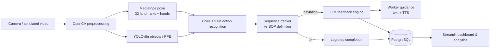

# FORGE-Vision

**A Hybrid Computer Vision and Generative AI System for Real-Time and Simulation-Based Employee Training**

[](https://doi.org/10.5281/zenodo.24079047)
[](LICENSE)

DBA Research project: Md Nasrullah Khan, Prof. Dr. Karim Mohammed Rezaul, Mashkur Alam and Md Jewel

FORGE-Vision watches a worker carry out a task, compares what it sees with the Standard Operating Procedure (SOP),
detects deviations, and gives instant, personalised, AI-generated corrective guidance. It is built in two phases:

- **Phase A — Simulation:** train and validate the models on synthetic, labelled video scenarios.
- **Phase B — Real time:** run the validated system on a live camera feed (webcam, phone, IP/RTSP camera).

> **Research status.** Phases 0–4 are complete. Phase 5 (academic evaluation) is running on **synthetic,
> clearly-labelled data**; the controlled study with real participants is waiting on ethics approval. Every number
> below comes from synthetic data unless stated otherwise. See [Research integrity](#research-integrity).

---

## What it does

| Capability | How |
|---|---|
| Detects SOP deviations | Action recognition (MobileNetV3-Small + 2-layer LSTM) feeds a sequence tracker that classifies `MISSING_STEP`, `WRONG_ORDER`, `INCORRECT_EXECUTION`, `MISSING_PPE`, `UNSAFE_POSTURE`, `TIMEOUT` |
| Explains every detection | Each event records **what** was wrong and **why** (confidence and reasoning), per the explainability rule |
| Generates corrective feedback | An LLM turns `{detected error, current step, SOP step, worker history}` into a short, supportive instruction. A rule-based fallback is used when no LLM is configured |
| Supports several LLM providers | Groq, Google Gemini, OpenAI, Anthropic, xAI and local Ollama, switchable at runtime in **Settings** |
| Guides a live session | Step-by-step flow with per-step timers, safety-critical confirmation, manual (offline) mode, optional text-to-speech |
| Analyses learning | Dashboards, leaderboards, time-to-competency prediction, bias audit by department, emotion/stress analytics |
| Tests the research hypotheses | t-test, ANOVA, paired t-test, Cohen's d, power analysis, assumption checks (`src/evaluation/`) |

## Architecture



Four layers — **Input → Processing (CV) → Intelligence (SOP detection + LLM) → Output (guidance, UI, analytics)** —
shared by both phases; only the input layer differs. Full design: [Architecture.md](Architecture.md).

## Results so far

Action-recognition model, trained on 1,200 **synthetic** clips (900 / 180 / 120 split, 5 scenario classes, seed 42, CPU):

| Metric | Target | Result |
|---|---|---|
| Test accuracy | ≥ 80% | **85.8%** |
| Macro F1 | — | 87.5% |
| Top-3 accuracy | — | 100% |
| p95 inference latency / sample | ≤ 500 ms | 62.1 ms |
| Model size / parameters | edge-ready | 8.8 MB / 2.3 M |

Test suite: 510 tests, all passing against the pinned dependencies (re-measured 2026-11-06); the core algorithmic modules measured 87% line coverage (2026-06-09) (the Streamlit UI layer and
run-once CLI entry points are validated manually — see [Rules.md](Rules.md) §5.4 for the honest breakdown).

## Quick start (Docker)

Requires Docker and Docker Compose.

```bash
git clone https://github.com/Mashkur2016/forge-vision.git
cd forge-vision
cp .env.example .env        # then edit .env: set JWT_SECRET_KEY and SETTINGS_ENCRYPTION_KEY
docker compose up -d --build
```

Generate the two secrets:

```bash
python -c "from cryptography.fernet import Fernet; print(Fernet.generate_key().decode())"   # SETTINGS_ENCRYPTION_KEY
openssl rand -hex 32                                                                          # JWT_SECRET_KEY
```

| Service | URL |
|---|---|
| Streamlit dashboard | http://localhost:8501 |
| FastAPI backend (+ `/docs` when `ENVIRONMENT` is not `production`) | http://localhost:8010 |
| React frontend | http://localhost:5173 |
| PostgreSQL | localhost:5433 |

**First sign-in.** `POST /api/v1/auth/register` always creates a `staff` user, so register once and then promote
the account in the database:

```sql
UPDATE users SET role = 'admin' WHERE email = 'you@example.com';
```

Then open **Settings** in the app and add an LLM key (Groq and Gemini have free tiers).

### Without Docker (Windows)

```powershell
python -m venv .venv ; .\.venv\Scripts\Activate.ps1
pip install -r requirements.txt
.\run_local.ps1        # starts the API and the React frontend
```

Python 3.11 is the tested version.

## Reproducing the pipeline

Model weights (`models/`) and the generated videos (`data/synthetic/`, about 20 GB) are **not** in this repository.
Regenerate them:

```bash
python -m src.simulation.dataset_builder        # 1,200 labelled synthetic clips from the SOPs in data/sops/
python -m src.training.trainer                  # trains the action recogniser, logs to MLflow (seed 42)
python -m src.training.evaluator                # writes experiments/eval_report.json
python -m src.evaluation.seed_simulation_data   # synthetic operational data for the dashboards
pytest                                          # test suite
```

## Deployment

A free hosted demo runs on a Hugging Face Docker Space with a Supabase Postgres database; a self-hosted path uses
Docker Compose with Caddy and Let's Encrypt. Both use the same topology and the live camera streams over a WebSocket.
Full steps, secrets and pitfalls: **[DEPLOYMENT.md](DEPLOYMENT.md)**.

> Free Supabase projects pause when idle and are eventually deleted. A scheduled ping keeps the demo alive
> (see DEPLOYMENT.md).

## Repository layout

```
src/
├── simulation/     SOP schema/parser, augmentation, scenario generator, dataset builder, LLM SOP parser
├── cv_pipeline/    frame preprocessing, pose, object detection, emotion detection
├── training/       models, datasets, trainer, evaluator
├── intelligence/   sequence tracker, SOP detector, feedback engine, LLM providers, competency predictor, continual learner
├── realtime/       camera capture, inference pipeline, session manager, TTS, latency benchmark
├── evaluation/     hypothesis tests, synthetic participants, experiment runner, data seeder
├── api/            FastAPI app, routes, schemas, security middleware
├── database/       SQLAlchemy models and session handling
└── ui/             Streamlit app and pages
frontend/           React (Vite + TypeScript) auth and onboarding UI
data/sops/          22 SOP definitions (YAML)
alembic/            database migrations
tests/              unit and integration tests, by phase
deploy/, space/     production Caddy config and Hugging Face Space runtime files
```

## Research design

| | |
|---|---|
| **H1** | FORGE-Vision-trained employees make significantly fewer task errors than traditionally trained ones (p < 0.05) |
| **H2** | The hybrid (simulation → real-time) approach transfers skill better than simulation-only or real-time-only |
| **H3** | Real-time AI feedback shortens task completion time compared with post-hoc feedback |

Method: control group, pre/post measurement, α = 0.05, power analysis (β = 0.80), effect sizes reported.
Hypothesis testing code lives in `src/evaluation/hypothesis_tester.py`.

## Research integrity

- All results above come from **synthetic** data, which is labelled as such in the database (every seeded row carries
  `@synthetic.forge.local`) and in reports. They validate the analysis pipeline, not the hypotheses on real workers.
- Real-participant tasks (recruitment, pre/post tests, the controlled study) require ethics approval and have not
  been run.
- The seeded dataset was regenerated on 2026-11-06: it holds 9,303 deviation events plus 4,665 emotion rows. The
  8,441 recorded at the first (June 9) seeding predates the Welding ×1.5 disparity injected for the bias audit;
  the seeder is deterministic and reproduces the current figures exactly. Figures built on the earlier dataset
  should be re-run or labelled with the dataset they used. Details in [TODOList.md](TODOList.md).

## Ethics and privacy

- Video is processed in memory and not stored; only numeric features are persisted.
- No real worker biometric data is stored without explicit consent (GDPR).
- The system is a training aid, not a disciplinary tool: feedback is advisory, workers are told they are monitored,
  and any worker can stop a session at any time.
- Feedback must be grounded in the detected action and use neutral, non-punitive language.

Full governance: [Rules.md](Rules.md).

## Documentation

| Document | Contents |
|---|---|
| [Architecture.md](Architecture.md) | System design, data flows, API, edge topology |
| [Rules.md](Rules.md) | Technical, ethical and academic rules, with a compliance record |
| [ProjectPhases.md](ProjectPhases.md) / [TODOList.md](TODOList.md) | Phase plan, approvals, session logs |
| [LiteratureReview.md](LiteratureReview.md), [GapsAnalysis.md](GapsAnalysis.md) | Research background and gaps |
| [LLM_Strategy.md](LLM_Strategy.md) | Provider strategy and cost policy |
| [SecurityEnhancements.md](SecurityEnhancements.md) | OWASP hardening |
| [DEPLOYMENT.md](DEPLOYMENT.md) | Self-hosted and Hugging Face + Supabase deployment |
| [SystemImplementationReport.md](SystemImplementationReport.md) | Detailed implementation report |

## Licence

No licence has been chosen yet. Until one is added, all rights are reserved by the author.
