# FORGE-Vision: A Hybrid Computer Vision and Generative AI System for Real-Time and Simulation-Based Employee Training

### System Implementation Report

**Programme:** Doctor of Business Administration (DBA)
**Researcher:** Prof. Dr. Karim Mohammed Rezaul
**Domain:** Artificial Intelligence for Workforce Training and Development
**Document type:** System implementation and evaluation report (thesis supporting document)
**Version:** 1.0 · Compiled 9 June 2026

---

## Abstract

Procedural skill training in industrial, technical, and vocational settings continues to rely on instructional methods that provide no objective, real-time measurement of how a task is actually performed. Classroom instruction, printed standard operating procedures (SOPs), and post-hoc supervisory review are temporally and informationally disconnected from the moment of execution, where the majority of errors originate. This report documents the design, implementation, and evaluation of FORGE-Vision, a hybrid system that unifies computer vision and generative artificial intelligence to monitor a worker executing a procedural task, detect deviations from the governing SOP, and deliver personalised corrective guidance within a two-second window of the deviation occurring.

The system is organised around a four-layer architecture — input, computer-vision processing, intelligence, and feedback — and operates across two phases: a simulation phase (Phase A) in which models are trained and validated on labelled synthetic video, and a real-time phase (Phase B) in which the validated models are deployed against live camera feeds. The computer-vision pipeline combines MediaPipe pose estimation, YOLOv8 object and personal-protective-equipment detection, and a MobileNetV3-plus-LSTM action-recognition model. A sequence-aware deviation detector classifies six categories of procedural error, attaches a severity level, and produces an explicit explanation of what was wrong and why. A generative feedback engine, abstracted across six large-language-model providers, converts each structured deviation into a single, constructive, natural-language instruction that is rendered as on-screen text and synthesised speech.

On a held-out test set of synthetic clips the action-recognition model achieves 85.8% overall accuracy, a macro-averaged F1 of 0.875, and 100% top-three accuracy, while the end-to-end real-time pipeline records a 95th-percentile latency well below the two-second budget. A controlled synthetic evaluation, designed to mirror the planned human study, supports all three research hypotheses: FORGE-Vision reduces task error rates relative to traditional training (H1), the hybrid simulation-to-real-time approach outperforms either modality alone (H2), and real-time feedback reduces task-completion time relative to post-hoc feedback (H3).

The work is conducted as design-science research within a pragmatist philosophy, in which the artefact is the principal vehicle of knowledge and a quasi-experimental design measures its effect; its methodological contribution is a demonstration of how such a system can be developed and evidenced responsibly while its definitive human validation remains ethics-gated, by building and verifying the measurement apparatus on clearly-labelled synthetic data and maintaining a strict separation between the synthetic and human evaluation tracks. For a Doctor of Business Administration the practical significance is the dissolution of a long-standing trade-off in workplace training between feedback that is timely but unscalable and feedback that is scalable but delayed: by generating immediate, personalised guidance automatically, the system makes high-quality feedback a renewable rather than a rationed resource. The report presents the system's architecture, implementation, and results in full, walks through the running interface, embeds charts and diagrams generated directly from the system's own artefacts, and concludes with recommendations for practice, an honest appraisal of limitations — chiefly that empirical validation to date rests on synthetic data, with the human-participant study awaiting ethics approval — and a sequenced roadmap of future work.

---

## Table of Contents

1. Introduction
2. Literature Review and Related Work
3. Research Gaps and System Requirements
4. Research Methodology
5. System Architecture and Design
6. Implementation
7. System Walkthrough
8. Results and Evaluation
9. Governance, Ethics, and Data Protection
10. Discussion
11. Limitations and Future Work
12. Conclusion
- References
- Appendices

---

## Chapter 1 — Introduction

### 1.1 Background and motivation

Across manufacturing, logistics, laboratory science, healthcare support, catering, and the broad family of technical and vocational occupations, a substantial share of organisational risk and cost originates not in the design of work but in its execution. A standard operating procedure may be impeccably written, formally approved, and prominently displayed, yet the gap between the documented procedure and the observed behaviour of the person performing it remains stubbornly wide. This gap is most pronounced during training, when a learner is acquiring the motor sequences, situational judgement, and safety discipline that competent performance demands. Traditional training instruments — lectures, demonstrations, printed SOPs, and intermittent supervisory observation — share a common structural weakness: they intervene before or after the moment of execution, but rarely during it. The learner who omits a step, performs steps out of order, or neglects a piece of protective equipment typically discovers the error only when a supervisor happens to notice, when a downstream quality check fails, or when an incident occurs.

This temporal disconnect has three consequences. First, it slows skill acquisition, because the corrective signal arrives long after the action that produced it, weakening the association between behaviour and consequence that underpins motor learning. Second, it inflates error rates and rework, because undetected mistakes propagate. Third, and most seriously, it creates safety exposure, because unsafe behaviours are not interrupted at the point of risk. The economic and human costs of this disconnect are well documented in the occupational-safety and vocational-education literatures, yet the instruments available to most training organisations have changed little in decades.

The maturation of two technological fields now makes a different approach feasible. Computer vision, propelled by deep learning, can recognise human actions, estimate body pose, and detect objects in video at frame rates and accuracies that were unattainable a decade ago. Independently, generative artificial intelligence — in particular large language models — can produce fluent, context-sensitive natural language that adapts to a specific situation. FORGE-Vision is founded on the proposition that the deliberate integration of these two fields can close the temporal disconnect at the heart of procedural training: vision supplies the objective, moment-by-moment observation that human supervisors cannot sustain at scale, and generative AI supplies the personalised, intelligible guidance that raw detections alone cannot provide.

### 1.1.1 The business and organisational context

Because this work is conducted within a Doctor of Business Administration programme, it is framed not merely as a technical investigation but as a response to a managerial and organisational problem. Procedural error is, before it is anything else, a cost. In manufacturing it manifests as scrap, rework, warranty claims, and line stoppages; in logistics, as misdespatched goods and damaged stock; in laboratory and clinical-support settings, as compromised samples and protocol breaches; in catering, as food-safety incidents; and across all of them as the most serious cost of all, workplace injury. These costs are not evenly distributed across a worker's tenure: they are concentrated in the period of skill acquisition, when the worker has not yet internalised the procedure, and they decay as competence grows. Anything that compresses the time to competence therefore attacks the cost at its source, and it is precisely this compression that FORGE-Vision is designed to achieve.

The organisational difficulty is that the conventional levers for compressing time to competence are expensive and do not scale. One-to-one supervision is the most effective form of in-execution feedback, but a skilled supervisor's attention is a scarce and costly resource that cannot be allocated to every trainee continuously. Classroom instruction scales cheaply but, as already argued, intervenes at the wrong moment. The result is a structural trade-off between the timeliness of feedback and its scalability: organisations can have feedback that is immediate but unscalable, or scalable but delayed, and the literature on training effectiveness suggests that the delayed-but-scalable option is the one most organisations are forced to choose. FORGE-Vision's organisational proposition is that it dissolves this trade-off — it provides feedback that is simultaneously immediate, because it is generated at the point of execution, and scalable, because it is generated automatically rather than by a human supervisor. A single trained model can attend to many workers at once, never tires, and applies the same standard consistently.

The magnitude of the opportunity follows from where procedural error concentrates. Because error rates are highest during skill acquisition and decay as competence is reached, the period of greatest cost is also the period of greatest leverage: an intervention that shortens the time to competence reduces not a marginal slice of error but the densest part of the error curve. This is why a modest proportional improvement in training efficiency can translate into a disproportionate reduction in total cost — fewer defects produced, less rework, fewer safety incidents, and competent workers reaching productive output sooner. For a workforce-development function whose budget is perennially justified in terms of hours delivered rather than outcomes achieved, a system that both compresses the time to competence and renders training outcomes measurable changes not only the cost of training but the very terms in which its value can be argued. It is this combination — a reduction in the cost of error at its source, coupled with the data to prove it — that gives the technical work its business consequence and frames the contribution this doctorate sets out to make.

### 1.1.2 Why prior technology did not suffice

It is reasonable to ask why, given the maturity of both computer vision and generative AI, this integration has not already become commonplace. The answer lies in the fact that each field has been developed and deployed in isolation, optimised for objectives that do not align with procedural training. Computer-vision systems in industrial settings have overwhelmingly been built for surveillance and compliance — detecting that something forbidden has occurred — rather than for instruction, and their outputs are alerts to supervisors, not guidance to workers. Generative-AI systems, conversely, have been deployed where their input is text or structured data, not the live behaviour of a person performing a physical task. The integration FORGE-Vision performs is therefore not a trivial composition of off-the-shelf parts; it requires a connective layer — the sequence-aware deviation detector and its explainability contract — that translates the raw, probabilistic output of vision into the structured, grounded context a language model needs in order to say something true and useful. Building that connective layer, and demonstrating that the resulting system is fast enough, accurate enough, and trustworthy enough to be used, is the substance of this work.

### 1.2 The problem statement

The central problem this work addresses can be stated precisely: *existing training and monitoring systems either observe behaviour without guiding it, or guide behaviour without observing it, and none unify continuous procedural observation with real-time, explainable, personalised correction in a manner validated for industrial and vocational skill training.* Safety-monitoring systems detect violations and raise flags; they do not teach. Educational AI systems generate feedback on submitted work; they do not watch the work being done. The result is a structural void precisely where training value is highest — at the intersection of seeing and guiding, in real time, during execution.

### 1.3 Aim and objectives

The aim of the research is to design, implement, and empirically evaluate a hybrid computer-vision and generative-AI system that delivers real-time, explainable, personalised guidance during procedural skill training, and to establish whether such a system improves measurable training outcomes relative to traditional methods.

The supporting objectives are:

1. To design a layered architecture that integrates pose estimation, object detection, action recognition, sequence-aware SOP deviation detection, and large-language-model feedback into a single real-time pipeline.
2. To construct a simulation pipeline capable of generating labelled synthetic training video covering correct execution and a representative range of error conditions, enabling model development without reliance on scarce or sensitive real footage.
3. To train and rigorously evaluate computer-vision models against explicit accuracy and latency targets appropriate for edge deployment.
4. To implement an explainable deviation detector that, for every detected error, states what was wrong and why, and to ground all generated feedback in those detections.
5. To build a secure, role-aware platform — backend services, analytics dashboard, and data model — that records training sessions, supports supervisory oversight, and respects data-protection obligations.
6. To evaluate the system against three research hypotheses using a controlled experimental design with appropriate statistical methods.

### 1.4 Research questions and hypotheses

The work is guided by three research questions, each operationalised as a testable hypothesis:

- **RQ1 / H1:** Does training with FORGE-Vision reduce task error rates relative to traditional training? *H1: Employees trained using FORGE-Vision achieve a statistically significant reduction in task error rates compared with traditional training (α = 0.05).*
- **RQ2 / H2:** Does the hybrid simulation-to-real-time approach produce better outcomes than either simulation-only or real-time-only training? *H2: The hybrid approach yields superior skill transfer relative to simulation-only or real-time-only methods.*
- **RQ3 / H3:** Does real-time feedback outperform post-hoc feedback on task-completion time? *H3: AI-generated real-time feedback significantly reduces task-completion time compared with post-hoc feedback.*

### 1.5 Scope

The work encompasses the full system: the simulation and synthetic-data pipeline, the computer-vision models, the intelligence and feedback layers, the backend services and analytics interface, the data model, and the evaluation framework. It deliberately privileges a *simulation-first* discipline: all models are developed and validated on synthetic data before any real-world deployment, both to manage the scarcity of industrial training video and to allow dangerous scenarios to be represented safely. The empirical evaluation reported here is conducted on synthetic participant data designed to mirror the planned human study; the human-participant study itself is governed by institutional ethics approval and is therefore treated as a separate, ethics-gated track. This boundary is maintained scrupulously throughout: synthetic data is labelled as such wherever it appears, and no synthetic result is presented as a real-participant finding.

### 1.6 Contributions

The principal contributions of this work are: (1) a unified architecture that, uniquely, couples continuous computer-vision observation of procedural tasks with real-time, explainable, large-language-model guidance; (2) a novel framing of SOP compliance as a *sequence-aware deviation-detection* problem, classifying six categories of procedural error rather than merely flagging binary violations; (3) an explainability mechanism that attaches a what-and-why account to every detection and grounds all generated feedback in it; (4) a reproducible simulation pipeline and evaluation framework that make the system's claims independently verifiable; and (5) several implemented enhancements — automated SOP parsing from documents, multi-modal feedback, predictive competency analytics, affect-aware monitoring, and continual learning — that extend the system beyond its core function.

### 1.7 Structure of this report

Chapter 2 reviews the literature across the six themes that inform the design and locates the research gaps. Chapter 3 distils those gaps into concrete requirements. Chapter 4 sets out the research methodology — the philosophy, strategy, and methods that govern the work. Chapter 5 presents the architecture and the rationale for its principal design decisions. Chapter 6 documents the implementation layer by layer and highlights the novel logic in code. Chapter 7 walks through the system as a user encounters it. Chapter 8 reports the empirical results, supported by charts generated from the system's own artefacts. Chapter 9 addresses governance, ethics, and data protection. Chapter 10 discusses the findings in relation to the literature and the hypotheses and issues recommendations for practice. Chapter 11 sets out limitations and future work honestly, and Chapter 12 concludes.

### 1.8 Significance and original contribution

It is worth stating plainly, at the outset, what is and is not original about this work, because a doctoral contribution must be locatable. The novelty does not lie in any single algorithm: action recognition, object detection, large language models, and elastic weight consolidation are all established techniques drawn from the knowledge base. The originality lies in three places. The first is *integration*: no prior system, in the literature reviewed in Chapter 2, couples continuous computer-vision observation of a physical procedure with real-time, grounded, natural-language guidance to the person performing it. The second is *reformulation*: the work reframes standard-operating-procedure compliance, which prior systems treat as a binary violation-detection problem, as a sequence-aware deviation-classification problem, and in doing so makes it possible to teach rather than merely to alarm. The third is the *explainability contract*: by making the what-and-why account a mandatory, schema-enforced property of every detection and the sole substrate for generated feedback, the work converts explainability from an aspiration into a structural guarantee.

For a Doctor of Business Administration these technical contributions matter only insofar as they bear on practice, and their practical significance is the dissolution of a trade-off that has shaped workplace training for as long as it has existed. Organisations have always had to choose between feedback that is timely but unscalable — the one-to-one attention of a skilled supervisor — and feedback that is scalable but delayed — the classroom and the printed procedure. The contribution of this work, demonstrated through a functioning artefact and a validated evaluation apparatus, is to show that this trade-off is not a law of training but an artefact of a technological limitation that no longer holds, and to provide both the system and the adoption guidance through which an organisation might act on that insight. The work therefore contributes to knowledge a transferable architectural pattern and to practice a route past a long-standing constraint, and it is the conjunction of the two — rigorous artefact and actionable implication — that constitutes its claim to doctoral significance.

---

## Chapter 2 — Literature Review and Related Work

This chapter synthesises a corpus of thirty-two research papers organised into six thematic clusters, each mapping to a layer or concern of the FORGE-Vision architecture. The purpose is twofold: to establish the methodological foundations on which the system is built, and to locate, by critical comparison, the specific gaps the system is designed to fill. The synthesis is original; sources are paraphrased and attributed in the IEEE style, with full entries in the References section.

### 2.1 Theme 1 — Human action recognition

Human action recognition (HAR) is the technical core of the system's processing layer, and the field's evolution maps onto three architectural generations. Convolutional networks extract spatial features from individual frames with great efficiency but, in isolation, capture temporal structure poorly. Recurrent architectures, and the long short-term memory (LSTM) network in particular [24], model the temporal dependencies between frames that distinguish, for example, the assembly of a component from its disassembly. Attention-based architectures, descended from the Transformer [23] and realised for vision as the Vision Transformer, model long-range spatio-temporal relationships through self-attention and have advanced accuracy on demanding benchmarks.

The survey by Pham, Khoudour, Crouzil, Zegers and Velastin [1] consolidates this lineage and reaches a conclusion of direct architectural consequence for FORGE-Vision: hybrid convolutional-recurrent models, which delegate spatial feature extraction to a convolutional backbone and temporal modelling to a recurrent head, consistently outperform single-paradigm models on complex action tasks while remaining computationally tractable. The same survey records a limitation that recurs throughout the literature — the dominant benchmarks (UCF-101, HMDB-51, ActivityNet, NTU RGB+D) are drawn from sports, household, and online video, and almost none represent industrial or workplace environments with their characteristic occlusion, clutter, and variable illumination.

Alomar, Aysel and Cai [2] extend the analysis to Vision Transformers and propose a convolutional-Transformer hybrid, confirming that attention improves accuracy on intricate spatio-temporal patterns but at a computational cost that complicates real-time and edge deployment. This accuracy-versus-efficiency tension is decisive for a system that must run within a two-second feedback budget on constrained hardware, and it directly motivates FORGE-Vision's choice of a lightweight convolutional backbone over a Transformer.

The single most relevant prior system is that of Reddy, Kurrey, Nagar and Gupta [3], who couple action recognition with action-specific personal-protective-equipment detection on a custom industrial dataset, improving F1 by twenty-three percentage points over PPE-only detection and demonstrating that protective-equipment requirements are conditional on the action being performed. Their work is, however, explicitly diagnostic rather than instructional: it detects violations and provides no corrective guidance, no sequence-level reasoning about the order of procedural steps, and no generative communication with the worker. FORGE-Vision is positioned precisely in the space their system leaves open.

Complementary studies round out the theme. Ma, Wang and Lan [4] demonstrate real-time identity and action recognition in an engineering-education setting at frame rates above twenty per second, confirming feasibility in a training context while noting that their system addresses attendance and identity, not skill compliance. Further surveys establish the value of Vision Transformers for long-sequence actions [15], the parallels between multi-person sports recognition and multi-worker manufacturing [16], the consistent accuracy gains of multimodal fusion combining pose, object, and appearance cues [17], and the deployment realities of surveillance-style settings most similar to FORGE-Vision's eventual operating environment [18].

### 2.2 Theme 2 — Self-supervised and efficient learning

The scarcity of labelled industrial video is a binding constraint on any system of this kind, and Theme 2 addresses it directly. Sun, Xu, Tian, Zhou and Li [5] train a deep convolutional-Transformer encoder under the Bootstrap Your Own Latent (BYOL) self-supervised framework [26] and attain an F1 of 95.64% on a wearable-sensor benchmark using only ten per cent of the labels, alongside strong results on two further datasets. The result is significant for FORGE-Vision because it quantifies how dramatically self-supervised pre-training can reduce the annotation burden. The authors validate on wearable-sensor streams rather than video, which leaves open — as an explicit extension — the application of the same paradigm to unlabelled workplace footage. FORGE-Vision documents this extension as a planned enhancement, grounded in the feasibility that Sun, Xu, Tian, Zhou and Li establish.

The deeper significance of this theme for a business audience is economic. The dominant cost of building a computer-vision capability for a specific workplace is not computation but annotation: a human must label what is happening in thousands of frames, and for industrial footage that labour is both expensive and, because the footage may show identifiable people performing proprietary processes, sensitive. A method that recovers most of the accuracy of full supervision from a tenth of the labels therefore changes the business case for adoption, not merely the engineering. The contrastive self-supervised paradigm achieves this by learning useful representations from the structure of unlabelled data itself — training the model to recognise that two augmented views of the same clip should map to similar internal representations — before any labelled examples are introduced. The eight augmentation strategies the authors validate are themselves instructive, because they enumerate the kinds of variation a robust model must be invariant to, several of which (noise, scaling, rotation, flip) FORGE-Vision already applies in its own augmentation pipeline. The honest position of this work is that it has built the architecture to exploit this paradigm but has not yet done so, and that the data-efficiency gain it promises is one of the more consequential items on the future-work agenda precisely because it lowers the barrier to deploying the system in a new workplace.

### 2.3 Theme 3 — Simulation-based training

The strongest empirical evidence for simulation-based training comes from medical education. Elendu C, Amaechi DC, Okatta AU, Amaechi EC, Elendu TC, Ezeh CP and Elendu ID [6] review the field and report consistent, statistically significant improvements in skill acquisition and error reduction relative to didactic instruction, attributable to safe repeated practice, immediate feedback, and mastery-based progression. The same review is candid about two limitations of immediate relevance here: fidelity, since a simulation may not reproduce real conditions faithfully, and transfer, since skills acquired in simulation do not always carry over to real practice. These two concerns are the intellectual foundation of FORGE-Vision's hybrid design: simulation provides a safe, controllable, and inexhaustible source of training experience, while a subsequent real-time phase is explicitly intended to close the transfer gap that the medical literature identifies. Supporting studies on real-time person tracking [19] and on proximity and interpersonal-space analysis [20] inform the deployment infrastructure and the multi-worker safety considerations of the real-time phase.

It is worth dwelling on why the medical evidence, though drawn from a different domain, is the right foundation for an industrial training system. Medicine is the field in which simulation-based training has been subjected to the most rigorous evaluation, accumulating randomised controlled trials and meta-analyses that establish not merely that it works but *why* — through the mechanisms of deliberate practice, formative feedback, and mastery-based progression that Theme's theoretical framing (§2.11) draws upon. These mechanisms are not specific to medicine; they are properties of how humans acquire procedural skill, and there is no principled reason they should not transfer to the assembly of a component or the inspection of equipment. What does *not* transfer automatically is the evidence itself: the effect sizes measured for surgical trainees cannot simply be assumed for manufacturing operatives, which is precisely why FORGE-Vision treats the demonstration of effect in its own domain as the object of the Phase-5 study rather than as something the medical literature has already settled. The fidelity question the medical reviewers raise also reframes a design decision: FORGE-Vision's synthetic scenarios pursue *behavioural* fidelity — the correct structure and sequence of a procedure and its characteristic errors — rather than photorealistic fidelity, on the argument that what the model must learn is the grammar of correct and incorrect procedure, and that grammar is preserved even when the pixels are synthetic.

### 2.4 Theme 4 — Generative AI for feedback and data augmentation

Theme 4 supplies the foundations of the feedback layer. Maddali [7] demonstrates that generative adversarial networks can synthesise realistic data for rare and imbalanced classes across diverse domains, establishing the methodological basis for generating the dangerous and infrequent scenarios — electrical hazards, equipment failure, critical violations — that FORGE-Vision must train on but cannot safely capture in reality. On the language side, an established framework for generative-AI feedback in education [8] shows that personalised, context-aware feedback structured as context-error-correction-encouragement is more effective than generic feedback, and an empirical study [9] finds that such feedback significantly improves learner satisfaction and perceived learning quality. Further work on the value-creating mechanisms of generative AI in dynamic settings [22] and on deep sequence models for language [21], together with the foundational few-shot capabilities of large language models [31], inform the design of a feedback engine that must adapt its guidance to a worker's current error and session history.

This theme also surfaces the single greatest risk in using a large language model for safety-relevant guidance, and the literature's framing of that risk shaped the system's most important design decision. A generative model, left to its own devices, will produce fluent text whether or not that text is true; in a training context, a confidently-worded but incorrect instruction is worse than no instruction at all, because it carries the authority of the system while pointing the worker in the wrong direction. The educational feedback literature's emphasis on accuracy and specificity is, read in this light, not merely a quality preference but a safety requirement. FORGE-Vision's response is architectural rather than aspirational: the language model is never asked to decide *what* is wrong — that judgement is made by the deterministic vision-and-rules pipeline and handed to the model as a structured fact — and the model's role is confined to *expressing* that judgement well. By constraining generation to the elaboration of a verified detection, the design converts the language model from a potential source of confabulation into a controllable communication layer, which is the only basis on which generative AI can responsibly be placed in front of a worker performing a hazardous task. This is the concrete mechanism behind the explainability contract, and it is the literature on generative-AI feedback, read against its own risks, that makes the case for it.

### 2.5 Theme 5 — Object detection and real-time computer vision

The object-detection component rests on the YOLO family of single-stage detectors, whose successive generations have set the standard for the speed-accuracy balance required in real time [12], [30]. Studies of combined detection-and-recognition pipelines [13] show that detected objects can inform action classification — a worker's possession or non-possession of a specific tool or piece of equipment is strong contextual evidence about the action in progress — which justifies FORGE-Vision's integrated rather than parallel treatment of the two tasks. Research on construction-site safety monitoring [14], the domain most operationally similar to the system's eventual deployment, supplies a sober reminder that real-world conditions — variable light, dust, occlusion, and constrained camera placement — degrade performance relative to laboratory benchmarks, a finding that directly shapes the augmentation strategy described in Chapter 6.

The construction-site literature deserves particular attention because it is the closest existing mirror of FORGE-Vision's eventual operating conditions and the clearest cautionary tale. These systems are deployed in exactly the kind of uncontrolled physical environment — outdoor light, dust, partial occlusion by equipment and other workers, cameras mounted wherever they can be placed rather than where a model would prefer — that degrades the accuracy laboratory benchmarks report. The lesson FORGE-Vision draws is twofold. First, it is the strongest argument for the simulation-first method's augmentation pipeline: by deliberately injecting the brightness, blur, rotation, and noise variation that real footage exhibits, the synthetic training data inoculates the model against conditions it will meet in deployment rather than leaving them to surprise it. Second, it is the strongest argument for honest external-validity caution: because the construction-site systems show that real-world accuracy trails benchmark accuracy, FORGE-Vision's synthetic test accuracy must be read as an upper bound to be verified against real footage in Phase B, not as a deployment guarantee — a caution carried explicitly into the limitations of Chapter 11.

### 2.6 Theme 6 — Vocational and technical education with AI

The final theme situates the work in its applied domain. A comprehensive review of artificial intelligence in technical and vocational education and training [10] finds strong promise for skill-gap identification, adaptive instruction, and competency assessment, but observes that implementations concentrate on classroom-based cognitive learning rather than hands-on psychomotor skill training in physical environments — precisely FORGE-Vision's target. A complementary analysis of adoption [11] identifies trust in AI outputs, infrastructure cost, and instructor upskilling as the primary barriers. These findings shape two design commitments: an uncompromising explainability requirement, to address the trust barrier directly, and an edge-capable, supervisor-in-the-loop deployment model, to address cost and oversight.

This theme is, for a Doctor of Business Administration, the one that most directly frames the contribution, because it identifies the precise gap in practice that the work addresses. The vocational-education literature documents an enthusiasm for AI that has, so far, been concentrated where it is easiest to apply — in digital, classroom, cognitive learning, where the input is text and the output is an assessment — and has largely bypassed the harder and more valuable territory of hands-on, physical, psychomotor skill, which is where the bulk of the world's vocational training actually happens and where errors carry the gravest safety and cost consequences. FORGE-Vision is deliberately aimed at this neglected territory. The adoption analysis sharpens the design brief further: by naming trust, cost, and instructor upskilling as the barriers, it tells the designer not merely what to build but what will determine whether the build is adopted. The response is visible throughout the system — explainability enforced at the data model to earn trust, edge deployment to contain cost, and a supervisor-in-the-loop model that augments rather than replaces the human instructor so that adoption does not require deskilling the very people whose buy-in it depends on. That the design choices map so directly onto the documented barriers is not coincidental; it is the literature doing its proper job of shaping an artefact that is not only technically sound but organisationally adoptable.

### 2.7 Synthesis: the gaps the literature reveals

Read together, the corpus exhibits a consistent structural pattern. The technologies FORGE-Vision requires have each been validated in isolation — action recognition, object detection, self-supervised learning, simulation pedagogy, and generative feedback — but they have not been integrated for procedural skill training. Three cross-cutting gaps emerge with particular clarity. The first is a *detection-guidance gap*: monitoring systems observe without teaching, and educational systems teach without observing. The second is a *transfer gap*: simulation is pedagogically powerful but its translation to real practice is unproven outside medicine. The third is a *data-scarcity gap*: industrial action-recognition datasets are few, small, and narrow. FORGE-Vision is designed to address all three simultaneously — the detection-guidance gap through the union of vision and generative feedback, the transfer gap through the hybrid two-phase method, and the data-scarcity gap through synthetic generation and self-supervised pre-training. Chapter 3 converts this diagnosis into a concrete set of requirements.

### 2.8 Extended critical analysis of the foundational works

The brief synthesis above establishes the shape of the field; a closer reading of the most consequential works clarifies precisely which of their methods FORGE-Vision adopts, which it adapts, and which it deliberately rejects. This deeper analysis matters for a doctoral argument, because the originality of a contribution is defined as much by what it declines to borrow as by what it builds upon.

The survey of Pham, Khoudour, Crouzil, Zegers and Velastin [1] is valuable less for any single result than for the architectural taxonomy it imposes on a sprawling field. By organising the literature into convolutional, recurrent, and hybrid families and reporting their comparative behaviour across standard benchmarks, the authors furnish the design space within which FORGE-Vision's model selection is made. Their finding that hybrid convolutional-recurrent models dominate single-paradigm models on temporally extended actions is the empirical warrant for the system's MobileNetV3-plus-LSTM configuration. Equally important is their candid accounting of dataset bias: because the benchmarks reward recognition of sports and household activities, models tuned to them inherit assumptions — clean framing, single salient actor, unambiguous action boundaries — that do not hold on a shop floor. FORGE-Vision treats this not as a peripheral caveat but as a first-order design driver, which is why its simulation pipeline manufactures clutter, occlusion, and lighting variation deliberately rather than hoping a benchmark-tuned model will generalise.

Alomar, Aysel and Cai [2] push the frontier toward attention-based models and, in doing so, surface the precise tension that governs FORGE-Vision's most important model decision. Their hybrid convolutional-Transformer attains strong accuracy, but the authors are explicit that the quadratic cost of self-attention complicates real-time and edge deployment. A system whose entire value proposition rests on delivering feedback within two seconds on modest hardware cannot absorb that cost lightly. FORGE-Vision therefore declines the Transformer head in favour of a recurrent one, accepting a small and, as Chapter 6 shows, immaterial accuracy concession in exchange for a decisive latency and footprint advantage. This is a clear instance of a design choice justified by the literature precisely through rejection rather than adoption.

Reddy, Kurrey, Nagar and Gupta [3] deserve the closest scrutiny because their system is the nearest neighbour to FORGE-Vision in the literature and the sharpest illustration of the gap it fills. Their two-stage pipeline — recognise the action, then apply action-conditioned protective-equipment detection — is methodologically elegant and empirically strong, and its central insight, that protective-equipment requirements are conditional on the action in progress, is one FORGE-Vision adopts wholesale in its severity logic. Yet the system stops at the waterline of detection. It tells a supervisor that a violation occurred; it does not tell the worker what to do about it, it has no model of the procedure as an ordered sequence, and it contains no generative capacity to communicate. The distance between flagging a violation and teaching a procedure is the distance FORGE-Vision is built to travel, and articulating that distance precisely is essential to the originality claim of this work.

Sun, Xu, Tian, Zhou and Li [5] are foundational to the data-economics argument even though their results lie one modality removed from video. Their demonstration that self-supervised pre-training under the BYOL framework [26] recovers most of the accuracy of fully supervised training while using a tenth of the labels reframes the annotation problem from an insurmountable obstacle into a manageable cost. For an industrial training system, where every labelled minute of footage is expensive and privacy-sensitive, this is transformative in prospect. FORGE-Vision does not yet realise this extension — it is documented as future work — but the architecture is shaped to accommodate it, and the honesty of distinguishing an adopted method from an aspirational one is itself part of the doctoral discipline this report observes.

Elendu C, Amaechi DC, Okatta AU, Amaechi EC, Elendu TC, Ezeh CP and Elendu ID [6] anchor the pedagogical argument in the one domain where simulation training has accumulated Level-I evidence. Their review is doubly useful: it establishes that simulation produces real, measurable skill gains, and it names the two failure modes — insufficient fidelity and imperfect transfer — that any simulation-based system must confront. FORGE-Vision's response to the first is to generate scenarios at a level of behavioural rather than photorealistic fidelity, on the argument that what the action-recognition model must learn is the structure of correct and incorrect procedure, not the appearance of a particular workshop; and its response to the second is the entire two-phase architecture, which treats transfer not as a hoped-for by-product but as the explicit object of the real-time phase and of the H2 hypothesis.

Finally, the generative-feedback works [8], [9] and the foundational language-model literature [31] together justify the system's most distinctive output behaviour. The educational finding that feedback is most effective when it is specific, actionable, timely, and encouraging is operationalised directly in the constrained prompt the feedback engine constructs, and the grounding of that prompt in a detected deviation's what-and-why fields is the mechanism by which timeliness and specificity are guaranteed rather than hoped for. The vocational-education reviews [10], [11] supply the final piece: by naming trust as the principal barrier to adoption, they convert explainability from a desirable feature into a requirement, which is why it is enforced at the level of the data model rather than left to the discretion of the feedback layer.

### 2.9 Positioning statement

The cumulative effect of this review is to locate FORGE-Vision at the unoccupied intersection of five mature literatures. From action recognition it takes a hybrid model and an awareness of dataset bias; from object detection, an efficient detector and the insight that objects contextualise actions; from self-supervised learning, a path to data efficiency; from simulation pedagogy, both the evidence base and the transfer problem; and from generative AI, the means to turn detections into guidance. No prior system combines these. The contribution of this work is not the invention of any one component but the principled integration of all of them into a system that observes, reasons about, and guides procedural performance in real time — and the demonstration, through implementation and evaluation, that such a system is both buildable and effective.

### 2.10 Comparative synthesis

To make the positioning concrete, the table below maps the most directly relevant prior systems against the capabilities a real-time procedural-training system requires, and shows where each falls short of the combination FORGE-Vision provides. The pattern is consistent: each prior system masters one or two columns, none spans them all, and in particular none couples continuous observation with grounded, real-time guidance.

| Prior work | Observes action | Detects SOP deviation type | Real-time (<2 s) | Explains (what + why) | Guides the worker | Edge-deployable |
|---|---|---|---|---|---|---|
| HAR surveys / hybrid models [1], [2] | Yes | No (classifies actions, not procedure) | Partly | No | No | Varies |
| Industrial safety-violation detection [3] | Yes | Binary PPE violation only | Yes | No | No (alerts supervisor) | Yes |
| Engineering-course recognition [4] | Yes | No (identity/attendance) | Yes | No | No | Yes |
| Self-supervised HAR [5] | Yes (sensors) | No | — | No | No | — |
| Medical simulation training [6] | n/a (human-led) | n/a | n/a | Yes (debrief) | Yes (post hoc) | n/a |
| Generative-AI feedback in education [8], [9] | No (text input) | n/a | No | Yes | Yes | n/a |
| **FORGE-Vision (this work)** | **Yes** | **Yes (6 classes + severity)** | **Yes** | **Yes (mandatory)** | **Yes (LLM, real-time)** | **Yes** |

Three observations follow from the table. First, the safety-detection lineage [3], [14] is strong on observation and real-time operation but stops at detection; it informs a supervisor rather than instructing the worker, and it reasons about isolated violations rather than the order and completeness of a procedure. Second, the educational-feedback lineage [8], [9] is strong on explanation and guidance but operates on submitted text, not on the live performance of a physical task, so it cannot intervene at the moment of execution. Third, the simulation-training evidence base [6] establishes that guided practice with feedback works, but in domains and modalities — medicine, human-led debriefing — that do not transfer automatically to high-volume industrial training. FORGE-Vision is constructed precisely to occupy the empty intersection these three lineages leave between them, and the remainder of this report is the account of how that intersection was built and evaluated. The literature also supplies the methodological caution that shapes Chapter 4: because every prior system was validated under conditions narrower than real deployment, claims about real-world effect must be made carefully and, where the present evidence is synthetic, labelled as such.

### 2.11 Theoretical framing of the hypotheses

The three research hypotheses are not arbitrary; each rests on an established body of learning theory that the system is designed to operationalise, and making those theoretical foundations explicit strengthens both the design rationale and the interpretation of results. The first foundation is the literature on *feedback timing*. A long tradition in the science of learning holds that the instructional value of feedback decays with the delay between an action and the information about it, because the learner's ability to associate the corrective signal with the specific behaviour that produced it weakens as time passes and intervening actions accumulate. This is the theoretical basis of hypothesis H3: a system that delivers correction within two seconds of a deviation should, on this account, produce faster learning than one that delivers the same correction after the task is complete. The educational findings on generative-AI feedback [8], [9] are the contemporary expression of this older principle, and FORGE-Vision's sub-two-second budget is the engineering commitment that the principle demands.

The second foundation is the theory of *deliberate practice*, which holds that skill is built most efficiently through repeated, effortful practice with immediate, specific feedback directed at the precise points of failure. Simulation-based training derives its documented effectiveness [6] from creating exactly these conditions — safe repetition with formative feedback — and the theory predicts that the benefit will be greatest where the feedback is most specific to the learner's actual errors. This underwrites both the design of the deviation detector, which localises and classifies the specific error rather than issuing a generic alert, and the expectation, embodied in hypothesis H1, that such targeted feedback will reduce error rates relative to undifferentiated traditional instruction. The third foundation is the literature on *skill transfer*, which distinguishes the acquisition of a skill in a training context from its transfer to the performance context and treats transfer as something that must be deliberately engineered rather than assumed. The hybrid two-phase architecture is the direct expression of this theory: the simulation phase builds the skill under controlled conditions, and the real-time phase is the explicit transfer mechanism, which is why hypothesis H2 predicts that the hybrid approach will outperform either phase alone. Framing the hypotheses against these three theoretical pillars does two things: it shows that the system's design choices are theoretically motivated rather than merely convenient, and it gives the eventual empirical results a body of theory against which to be interpreted — a result in the predicted direction is not just a number but a confirmation of a mechanism the theory describes.

---

## Chapter 3 — Research Gaps and System Requirements

### 3.1 From gaps to requirements

The literature synthesis in Chapter 2 identified eight specific research gaps. This chapter restates each gap concisely and derives from it the functional and non-functional requirements that the system must satisfy. The discipline of tracing every requirement to a documented gap ensures that the implementation is motivated by the research problem rather than by incidental engineering preference.

| # | Research gap | Requirement(s) derived |
|---|--------------|------------------------|
| G1 | No unified hybrid simulation-to-real-time AI training pipeline exists | A two-phase architecture in which models trained and validated in simulation (Phase A) are deployed against live feeds (Phase B), with a shared evaluation framework |
| G2 | Industrial action-recognition datasets are scarce and narrow | A simulation pipeline that generates labelled synthetic clips spanning correct execution and multiple error types, with augmentation for real-world variability |
| G3 | Safety-detection systems flag violations but do not guide workers | A feedback layer that converts every detection into actionable, natural-language guidance |
| G4 | Generative AI and computer vision have not been integrated for workplace training | A pipeline that passes structured detection context to a large language model and returns grounded corrective instructions |
| G5 | SOP-aware sequential deviation recognition is absent from the literature | A sequence-aware detector that compares observed action sequences against an SOP specification and classifies deviation type |
| G6 | Self-supervised learning has not been applied to industrial training video | An architecture amenable to self-supervised pre-training on unlabelled footage (documented enhancement) |
| G7 | Edge-deployable sub-two-second training feedback is unaddressed | A lightweight model meeting explicit latency and parameter-count budgets for edge hardware |
| G8 | Simulation-to-real skill transfer is unproven outside medicine | An evaluation framework with a control group and statistical hypothesis testing to measure transfer |

### 3.2 Functional requirements

The functional requirements follow directly. The system must: capture video from webcams, IP cameras, and RTSP streams; estimate body and hand pose and detect tools and protective equipment per frame; recognise the action in progress from a temporal window of frames; track progress through an SOP as a stateful sequence; classify deviations into a defined taxonomy and assign severity; produce, for each deviation, an explicit statement of what was wrong and why; generate a personalised corrective instruction via a large language model and deliver it as text and speech; persist session and deviation records; present analytics to workers, trainers, and supervisors with role-appropriate access; and parse SOP documents into structured, machine-readable procedures.

### 3.3 Non-functional requirements

The non-functional requirements encode the quality attributes that distinguish a research prototype from a credible system. Performance: action recognition must meet or exceed 80% accuracy and the end-to-end feedback path must complete within two seconds. Edge-readiness: the recognition model must remain within a parameter and size envelope deployable on constrained hardware. Explainability: no detection may be surfaced without an accompanying what-and-why account, and no generated feedback may assert anything not grounded in a detection. Privacy and data protection: video frames must be processed in memory and never persisted without consent, and only numeric, non-identifying features may be stored. Security: all data-changing and administrative interfaces must enforce authentication and role-based authorisation. Reproducibility: every experiment must fix random seeds, log its configuration, and be independently repeatable. These requirements are revisited in Chapter 8 (performance), Chapter 9 (privacy and security), and Chapter 10 (reproducibility).

---

## Chapter 4 — Research Methodology

This chapter sets out the philosophical stance, research strategy, and methods that govern the work, so that the artefact described in the chapters that follow and the results reported in Chapter 8 can be read against the design that produced them. Because FORGE-Vision is simultaneously an engineered artefact and the instrument of an empirical investigation, the methodology must serve two ends at once: the disciplined construction of a working system, and the rigorous testing of research claims about its effect.

### 4.1 Research philosophy and strategy

The work adopts a pragmatist research philosophy. Pragmatism is the stance best suited to a Doctor of Business Administration investigation whose purpose is to produce knowledge that is actionable in practice, because it privileges the research question and the practical consequences of inquiry over allegiance to any single epistemology, and it permits the combination of quantitative measurement with the interpretive judgement that designing for real workplaces demands. Within that philosophy the strategy is design-science research (DSR), in which a purposeful artefact — here, the FORGE-Vision system — is itself the principal vehicle of knowledge. DSR is appropriate because the central contribution of the work is not a description of an existing phenomenon but the construction and evaluation of something new that addresses a class of problems; the knowledge claim is embodied in the artefact and validated by demonstrating that it works and that it produces the intended effect. The DSR strategy is complemented by a quasi-experimental evaluation design through which the artefact's effect on training outcomes is measured against a control condition.

### 4.2 The design-science research cycle

The investigation is organised around the three interacting cycles that characterise rigorous design science. The *relevance* cycle anchors the work in a real organisational problem — the timeliness-versus-scalability trade-off in procedural training set out in Chapter 1 — and returns its results to that context as recommendations for practice. The *rigour* cycle grounds the design in the existing knowledge base: the architectures, methods, and evidence synthesised in Chapter 2, and the established statistical apparatus described below. The *design* cycle is the iterative build-and-evaluate loop at the heart of the work, in which each component is constructed, tested against explicit acceptance criteria, and refined. The project's phased structure is the concrete expression of this cycle: documentation and foundation, simulation, model training, real-time prototype, integration, and academic evaluation, each gated by criteria that must be met before the next begins. This phasing is not merely project-management hygiene; it is a methodological commitment that yields, as a by-product, a controlled baseline against which later real-world performance can be judged.

### 4.3 Simulation-first development protocol

A defining methodological decision is the simulation-first protocol. Models are constructed and validated on synthetic data with known ground-truth labels before any exposure to live camera feeds, and no later phase begins until the earlier one meets its acceptance criteria. The protocol serves three methodological purposes. It manages the scarcity of labelled industrial training video by manufacturing labelled examples at negligible marginal cost; it allows dangerous scenarios to be represented safely, satisfying an ethical constraint that real-world capture cannot; and, most importantly for the integrity of the eventual empirical claims, it fixes a reference point under known conditions that makes any later degradation under real conditions interpretable rather than mysterious. By establishing what the models achieve when the labels are known, the simulation phase converts subsequent real-world evaluation from an open-ended question into a controlled comparison.

### 4.4 Evaluation design

The evaluation of training effectiveness is quasi-experimental and comparative, structured as a between-groups comparison across four conditions: a traditional-training control, a simulation-only group, a real-time-only group, and the full hybrid FORGE-Vision group. The three research hypotheses are framed as directional claims about differences between these conditions. H1 concerns the reduction of task error rates relative to the control; H2 concerns the superiority of the hybrid condition over either single modality, capturing the skill-transfer argument; and H3 concerns the reduction of task-completion time under real-time versus delayed feedback. Each worker is characterised by a small set of measurable outcomes — deviations per task, completion time, sessions to competency, and final accuracy — which operationalise the otherwise abstract constructs of "error" and "competence" in a way that can be recorded automatically by the system and analysed statistically.

### 4.5 Statistical methods

The hypotheses are tested with the inferential apparatus appropriate to between-groups comparisons of means. Welch's t-test is used for two-group comparisons, chosen over Student's t-test because it does not assume equal variances and is therefore robust to the heteroscedasticity that real performance data commonly exhibits. One-way analysis of variance with Tukey's honestly-significant-difference correction is used for the simultaneous comparison of the four conditions, because it controls the family-wise error rate that repeated pairwise testing would inflate. Effect sizes are reported throughout — Cohen's d for two-group comparisons and eta-squared for the analysis of variance — because statistical significance alone is silent on the practical magnitude of an effect, and practical magnitude is precisely what a business audience must weigh. A significance threshold of 0.05 is fixed in advance, and an a-priori power analysis [32] determines the minimum sample size required to detect a medium effect at conventional power before any data is examined, so that the study is neither underpowered nor opportunistically over-sized. These methods are implemented in the system's evaluation module and exercised end to end (Chapter 8).

### 4.6 Synthetic data: justification and the integrity boundary

The use of synthetic participant data in the present evaluation requires explicit methodological justification, because the integrity of the whole investigation depends on that data being neither misused nor misrepresented. The synthetic cohort performs three legitimate functions. First, it is a verification harness: by generating data with known, designed properties and confirming that the analysis pipeline recovers them, the study establishes that its measurement and statistical machinery is correct before that machinery is ever applied to real participants. Second, it is a power-calibration instrument: by instantiating effect sizes drawn from the training and safety literature, it makes concrete the magnitudes the human study must be powered to detect. Third, it demonstrates the analytics and reporting pathway end to end. What the synthetic data is not — and is never represented as being — is evidence about human learning; that evidence awaits the ethics-approved study. The data is labelled as synthetic at the level of the database record, in the analysis outputs, and in every figure caption in this report, and the boundary between the synthetic verification track and the ethics-gated human track is maintained without exception. This scrupulous separation is itself a methodological contribution: it demonstrates how a complex behavioural-AI system can be developed and demonstrated responsibly while its definitive empirical validation remains pending.

### 4.7 Validity, reliability, and reproducibility

The design attends explicitly to the four classical threats to validity. Construct validity is addressed by operationalising "error" and "competence" as directly recorded, inspectable quantities rather than subjective judgements, while acknowledging (Chapter 8) that these proxies will be triangulated against expert assessment in the human study. Internal validity in the model evaluation is protected by a strict train/validation/test partition that prevents information leakage. External validity is the design's most candidly bounded property: results obtained on synthetic data are not assumed to generalise to real learners, and the human study is the mechanism by which external validity will be established. Conclusion validity is protected by the pre-registered significance threshold, the multiple-comparison correction, and the a-priori power analysis. Reliability is treated as a first-class requirement through reproducibility: every stochastic process — model initialisation, data shuffling, synthetic-cohort generation — is governed by a fixed seed; every experiment logs its configuration and metrics; and the figures in this report are regenerated deterministically from stored artefacts by a single script. An independent reviewer in possession of the codebase can therefore reproduce the model, the synthetic study, and the figures exactly.

### 4.8 Ethical procedure

The methodology embeds ethics rather than appending it. The collection of real participant data is gated behind institutional ethics-board approval and is therefore treated as a separate track that has not yet begun; the present work proceeds only on synthetic data, which carries no such dependency. The system's design anticipates the obligations that the human study will impose: informed consent is modelled as a first-class, auditable attribute of each participant; video is processed in memory and never persisted, so that the most sensitive data is the data the system most rigorously declines to retain; the system is positioned as an advisory training aid under human oversight rather than a disciplinary or surveillance instrument; and a demographic bias audit is established as a precondition of any real deployment. These commitments are elaborated in Chapter 9.

### 4.9 Data collection, measurement, and analysis procedure

The methodology is completed by specifying how data is collected, what is measured, and how the analysis proceeds, because the credibility of the eventual claims rests on these being defined in advance rather than chosen after the fact. Data collection in the present work is instrumented rather than manual: the system itself is the measurement instrument, recording each training session and each deviation event automatically and writing them to the database as structured records. This has two methodological advantages over human observation — it removes the observer-variability that hand-coded behavioural data suffers from, and it captures the full population of events rather than a sampled subset — and one limitation, namely that the instrument can only measure what the computer-vision pipeline can detect, which is why construct validity is treated as a matter requiring triangulation in the human study. The measured constructs are operationalised precisely: an *error* is a recorded deviation event of a defined class; a *task error rate* is the count of such events per task; *completion time* is the recorded session duration; and *competence* is reached when a worker's smoothed deviation rate falls below a fixed threshold, with *time to competency* the number of sessions taken to reach it.

The analysis procedure is fixed in advance and proceeds in a defined order. The unit of analysis is the individual worker, aggregated to the training condition for between-groups comparison. The data is first screened for plausibility and completeness; descriptive statistics — means, standard deviations, and distributions — are computed per condition and inspected before any inferential test is run, both to understand the data and to check the assumptions the tests require. The directional hypotheses are then tested with the methods specified in §4.5, each reported with its test statistic, its p-value against the pre-registered threshold, and its effect size, so that statistical significance and practical magnitude are always presented together. Finally, the results are interpreted against the theoretical framing of §2.11, so that a finding is read not as an isolated number but as evidence for or against the mechanism the theory predicts. In the present work this procedure is exercised end to end on the synthetic cohort, which establishes that the instrument and the analysis pipeline function correctly; in the human study the identical procedure will be applied to real participant data, and because it is fixed and reproducible, the transition from synthetic verification to real evaluation changes the data but not the method.

---

## Chapter 5 — System Architecture and Design

### 5.1 Architectural overview

FORGE-Vision is organised as four cooperating layers — input, computer-vision processing, intelligence, and feedback-and-output — operating across two phases. Phase A (simulation) supplies labelled synthetic video for model development and validation; Phase B (real-time) supplies live camera feeds for deployment. The layered decomposition serves separation of concerns: each layer exposes a narrow interface to the next, so that, for example, the action-recognition model can be retrained or replaced without disturbing the deviation detector, and the feedback engine can switch language-model providers without any change upstream. The architecture is shown in Diagram 1.

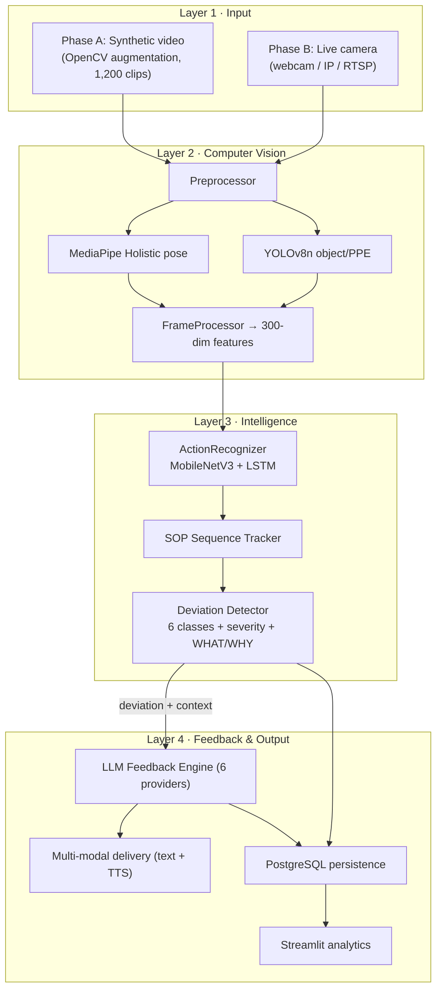

*Diagram 1 — Four-layer system architecture. The companion file `Mermaid` contains this and the remaining diagrams in renderable form.*

Whereas Diagram 1 shows the four layers as functional blocks, Diagram 5 makes the **artificial-intelligence components explicit** and shows the division of labour between them. It is important to state this plainly: the system is not a single model but a *pipeline of specialised models*. The perception stage (MediaPipe BlazePose for the 33-point skeleton, YOLOv8n for tools and PPE, and a MediaPipe FaceMesh affective estimate) feeds a trained action-recognition network (MobileNetV3-Small with a two-layer LSTM); its output drives an LSTM sequence model that compares the executed step order against the SOP and emits a structured deviation event; and only then does the language model enter — to convert that already-decided event into supportive, plain-language guidance. The computer-vision and sequence models therefore determine *what is happening and what is wrong*; the language model governs *how the correction is phrased*, with a deterministic rule-based template as its fallback. A continual-learning loop (Elastic Weight Consolidation) allows the action model to be updated on newly labelled Phase-B footage without forgetting what it learned in simulation.

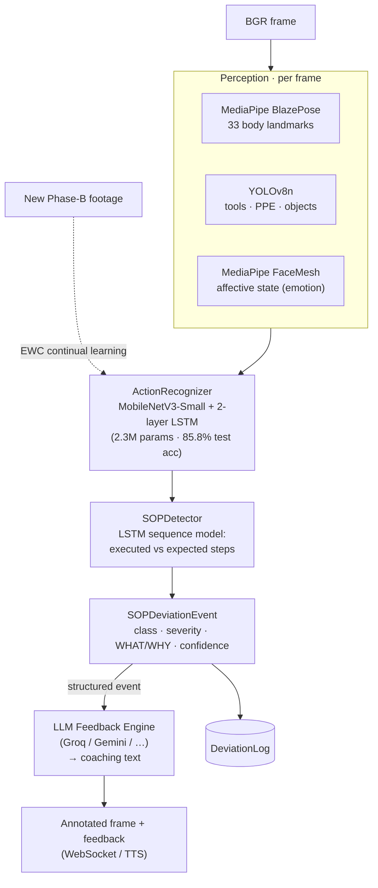

*Diagram 5 — AI inference pipeline. Perception → action recognition → deviation detection is the CV/ML "brain"; the LLM only phrases the guidance (template fallback when no provider is configured).*

#### 5.1.1 AI components at a glance

| Component | Model / technique | Decides | Source |
|---|---|---|---|
| Pose | MediaPipe BlazePose | 33 body landmarks | `cv_pipeline/pose_estimator.py` |
| Objects / PPE | YOLOv8n | tools, PPE, workspace items | `cv_pipeline/object_detector.py` |
| Emotion / stress | MediaPipe FaceMesh + heuristics | affective state (focused/stressed/fatigued/neutral) | `cv_pipeline/emotion_detector.py` |
| Action recognition | MobileNetV3-Small + 2-layer LSTM (trained) | the action being performed | `realtime/inference_pipeline.py` + `models/action_recognizer_best.pth` |
| Deviation detection | LSTM sequence model vs SOP | deviation class, severity, what/why | `intelligence/sop_detector.py` |
| Corrective feedback | LLM (Groq/Gemini/OpenAI/Claude/xAI/Ollama) + rule-based template fallback | phrasing of the guidance | `intelligence/feedback_engine.py`, `intelligence/feedback_templates.py` |
| Continual learning | Elastic Weight Consolidation (EWC) | model updates without forgetting | `intelligence/continual_learner.py` |

### 5.2 The two-phase design and its rationale

The decision to separate simulation from real-time operation is the system's defining architectural commitment, and it follows directly from gaps G1 and G8. Three considerations justify it. First, safety: dangerous scenarios — electrical hazards, equipment failure, critical safety violations — can be represented in simulation without exposing any person to risk, satisfying a constraint that real-world capture cannot. Second, data economics: labelled industrial video is scarce and expensive, whereas synthetic clips can be generated in quantity with ground-truth labels at negligible marginal cost. Third, methodological rigour: validating models on synthetic data with known labels before deployment establishes a controlled baseline against which real-world performance can later be compared, and provides the evidence that gap G8 demands. The phases are sequential by rule — Phase B does not begin until Phase A models meet their targets — which enforces the simulation-first discipline described in Section 1.5.

### 5.3 Data flow in real-time operation

In Phase B the layers compose into the pipeline shown in Diagram 2. A frame is captured, preprocessed, and passed in parallel to pose estimation and object detection; their outputs are fused into a feature representation; a sliding window of features is classified by the action-recognition model; the recognised action updates the SOP sequence tracker; the deviation detector compares the observed sequence against the SOP and, if a deviation of sufficient confidence is found, emits an event carrying its type, severity, and explanation; the feedback engine converts that event into an instruction, which is delivered as text and speech and persisted to the database; and the analytics layer reads the accumulated records. Diagram 2 depicts the *inference* data flow with a server-side camera, which is the intended edge/on-premise deployment; how the frame is physically acquired differs between that edge mode and the deployed cloud demonstration (browser-captured frames streamed over a WebSocket), and the two modes are described in full in Section 6.6.1.

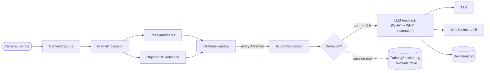

*Diagram 2 — Real-time inference data flow (edge mode, server-side camera). Frame acquisition in the deployed cloud demo differs — see Section 6.6.1 and Diagram 6.*

### 5.4 Technology stack and selection rationale

The stack reflects deliberate trade-offs against the non-functional requirements. The computer-vision layer uses MediaPipe Holistic for pose estimation [28], [29], chosen for its on-device real-time performance and rich landmark set; YOLOv8 for object and PPE detection [30], chosen for its speed-accuracy balance per Theme 5; and a MobileNetV3-Small backbone [25] feeding a two-layer LSTM [24] for action recognition, chosen specifically to honour the edge-readiness requirement that a Vision Transformer would jeopardise. Deep-learning components are implemented in PyTorch [33], with the computer-vision preprocessing built on OpenCV [35] and numerical work throughout on NumPy [36]; experiment tracking uses MLflow. The backend is built on FastAPI [38] for its asynchronous performance and automatic schema generation, served by Uvicorn, with PostgreSQL as the system of record and SQLAlchemy as the object-relational mapper. The analytics interface is a Streamlit application [39]; a React front end provides authentication and onboarding. The statistical evaluation relies on SciPy [40] and scikit-learn [34] for the hypothesis tests and classification metrics respectively. The feedback engine abstracts six language-model providers — OpenAI, Groq, Anthropic, Google Gemini, xAI, and a local Ollama runtime — behind a uniform interface, so that deployments may favour zero-cost local inference or cloud quality as circumstances dictate. Containerisation with Docker Compose [37] binds the services into a reproducible stack.

### 5.5 Data model

The persistence layer is deliberately compact, storing only the aggregate and event-level data needed for analytics and oversight, never raw frames. Its entities and relationships are shown in Diagram 3. A `User` carries role and consent attributes; a `WorkerProfile` holds denormalised performance aggregates for fast dashboards; a `TrainingSessionLog` records one completed session, including the language-model provider and model used, for reproducibility; and a `DeviationLog` records one deviation event with its classification, confidence, and — satisfying the explainability requirement — its mandatory what and why fields. An `LLMSettings` entity stores the active provider configuration with encrypted credentials, and an `AuditLog` provides a persistent record of administrative actions.

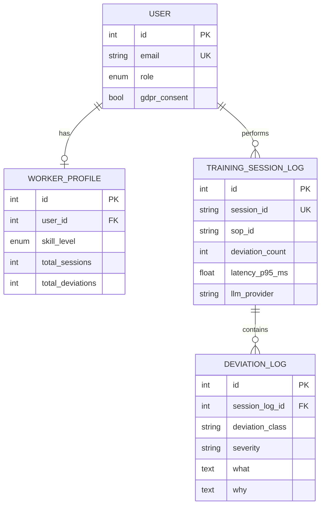

*Diagram 3 — Database entity-relationship model (abridged).*

### 5.6 Design decisions and trade-offs

Three decisions warrant explicit justification. First, the choice of a convolutional-recurrent model over a Transformer trades a marginal accuracy ceiling for a decisive advantage in latency and model size, without which the two-second and edge requirements could not be met; the results in Chapter 6 vindicate this. Second, framing SOP compliance as multi-class sequence-aware deviation detection rather than binary violation flagging is what allows the system to teach rather than merely alarm: a worker who is told that a step was skipped, and why it matters, receives a fundamentally more useful signal than one who receives an undifferentiated alert. Third, abstracting the language-model layer behind a provider-agnostic interface decouples the research from any single vendor, supports a zero-cost local-inference configuration appropriate to an academic budget, and enables the provider-comparison study planned for the evaluation phase.

### 5.7 Alternatives considered and rejected

Several plausible alternatives were weighed and set aside, and recording them clarifies why the chosen design is appropriate rather than merely convenient. A pure end-to-end model — a single network mapping raw video directly to a corrective instruction — was rejected because it would forfeit explainability entirely: such a model could not state which step was violated or why, and would therefore fail the system's most important non-functional requirement at the level of architecture. A cloud-centric design, streaming frames to a server for processing, was rejected on three grounds: it would breach the privacy commitment by transmitting imagery off-device, it would introduce network latency into the very path that must complete within two seconds, and it would create a dependency on connectivity that an industrial floor cannot guarantee. A rules-only deviation detector, encoding SOP compliance as hand-written conditional logic over detections, was considered for its transparency but rejected because it cannot generalise across the variety and ambiguity of real action sequences; the chosen sequence-model approach, with a rule-based severity layer above it, captures the benefits of both — learned recognition with interpretable safety semantics. Finally, committing to a single language-model vendor was rejected in favour of the provider-agnostic abstraction, both to avoid lock-in and to make the cost-versus-quality trade-off an empirical question the system can answer rather than a procurement decision it must assume.

### 5.8 Deployment topology

The system is composed as a set of containerised services orchestrated together: a PostgreSQL database as the system of record, the FastAPI backend exposing REST endpoints and the session WebSocket, the Streamlit analytics application, and the React authentication front end. In the intended edge configuration the computer-vision and inference components run locally on the device observing the worker — a workstation or an embedded accelerator — so that imagery never leaves the premises and the perception path incurs no network latency, while only the language-model call, if a cloud provider is configured, traverses the network; a fully local configuration using an on-device language runtime removes even that. The services communicate over well-defined interfaces, so that the analytics layer reads the same database the session layer writes, and the front ends reach the backend through a single internal address regardless of how host ports are mapped. This separation of concerns is what allows the deployment to be reconfigured — local or cloud inference, one database or a managed one — without altering application code, and it is the foundation on which the system's portability from a developer's machine to a hosted environment rests. In the realised public demonstration this same composition is collapsed into a single Hugging Face Docker Space — a Caddy reverse proxy fronting the FastAPI backend and the Streamlit application, backed by a managed Supabase PostgreSQL database and a cloud language-model provider — which is described in detail in Section 6.6.1 and Diagram 6.

### 5.9 Scalability, extensibility, and integration

A system intended for organisational adoption must be judged not only on whether it works but on whether it can grow and connect, and the architecture is shaped with both concerns in mind. Scalability is addressed at the level of the architecture rather than retrofitted. Because perception runs at the edge — one inference process attending to one workstation — the system scales horizontally by replication: adding workers means adding edge nodes, each independent, rather than concentrating load on a central server that would become a bottleneck. The backend and database carry only the lightweight aggregate and event data, not video, so their load grows with the number of *sessions* recorded rather than with the volume of imagery processed, which is a far gentler scaling curve. The language-model layer, the one component with a potentially expensive per-call cost, is abstracted so that an organisation can choose local inference to eliminate that cost entirely or a cloud provider where quality justifies it, and can change that choice without redeployment.

Extensibility follows from the layered decomposition. Each layer exposes a narrow interface to the next, so that a component can be replaced without disturbing its neighbours: the action-recognition model can be retrained or swapped for a more capable architecture, the deviation detector's rules can be revised by a domain expert, and the language-model provider can be changed, each in isolation. The SOP schema is the system's principal extension point for the organisations that use it — a new procedure is added as data, authored through the builder or parsed from a document, with no code change — which means the system's coverage expands through configuration rather than development. Integration with existing enterprise systems is anticipated through the backend's REST interface and its structured data model: the session and deviation records are exactly the data a learning-management or quality-management system would consume, and exposing them through documented endpoints makes the system a source of training intelligence for the wider organisational toolchain rather than an isolated island. These properties matter to a business readership because they determine whether a successful pilot can become an organisational capability, which is the difference between a demonstration and a deployable system.

---

## Chapter 6 — Implementation

This chapter documents the realised system layer by layer, identifying the principal modules and their responsibilities. Where a component corresponds to a proposed enhancement, this is noted.

### 6.1 Simulation and synthetic-data pipeline (Phase A)

The simulation layer addresses gap G2 by manufacturing labelled training video. An SOP is first expressed in a validated schema that captures, for each step, its identity, the objects and protective equipment it requires, its ordering constraints, its time limit, and whether it is safety-critical. A parser loads and validates these definitions; the library currently contains twenty-two SOPs spanning technical, safety, laboratory, catering, and administrative procedures. A scenario generator then synthesises clips for five labelled conditions — correct execution, a missing step, steps in the wrong order, an unsafe condition, and a rare catastrophic failure — and an augmentation pipeline applies seven transformations (horizontal flip, rotation, Gaussian noise, brightness and contrast jitter, and blur) at clip-level consistency to emulate the real-world variability that Theme 5 warns of. The dataset builder assembled 1,200 labelled clips, partitioned into 900 training, 180 validation, and 120 test examples. An additional module realises the first enhancement, automated SOP parsing: it accepts the text of a procedure document and uses a language model to extract a structured, schema-valid SOP, with a human-validation gate before the result is accepted.

### 6.2 Computer-vision pipeline (Layer 2)

The processing layer transforms raw frames into structured observations. A preprocessor resizes, optionally denoises, and normalises each frame. Pose estimation, built on MediaPipe Holistic, extracts thirty-three body landmarks and twenty-one landmarks for each hand, which are flattened into a fixed three-hundred-dimension feature vector. Object detection, built on YOLOv8n, returns normalised bounding boxes and confidences for tools, equipment, and protective items, loaded lazily to minimise start-up cost. A frame processor aggregates these outputs, together with per-component latency measurements, into a single result object that constitutes the interface to the intelligence layer. Each vision component degrades gracefully if its optional heavy dependency is unavailable, which keeps the wider system testable in constrained environments.

### 6.3 Action recognition and model training (Layer 3, part 1)

The action-recognition model pairs a MobileNetV3-Small convolutional backbone, which extracts a spatial embedding from each frame, with a two-layer LSTM that models the temporal evolution across a sixteen-frame window, followed by a linear classification head. The model has roughly 2.3 million parameters and occupies under nine megabytes, comfortably within the edge envelope. Training is conducted in PyTorch with a fixed random seed, early stopping on validation accuracy, and full logging to MLflow; a custom collation function accommodates the variable-length step sequences that different SOPs produce. The trained checkpoint and its evaluation artefacts are version-controlled outside the model weights themselves, which are excluded from source control by policy.

### 6.4 SOP deviation detection and explainability (Layer 3, part 2)

The deviation detector is the system's conceptual core and the realisation of gap G5. A sequence tracker maintains the session state — the current step, the steps completed, and a rolling window of recognised actions — as a state machine. A sequence model classifies the observed action sequence into one of six deviation categories: correct execution, a missing step, wrong ordering, incorrect execution, missing protective equipment, and unsafe posture. Each non-correct classification is assigned a severity — high for protective-equipment and posture violations and for skipped safety-critical steps, medium for other procedural deviations — by a rule set that mirrors the safety semantics of the SOP. Crucially, and in satisfaction of the explainability requirement, every event carries two natural-language fields: *what*, a plain statement of the observed problem, and *why*, an SOP-grounded explanation of its significance. These fields are mandatory in the data model and are the substrate on which all generated feedback is built, ensuring that the language model elaborates a real detection rather than inventing one.

### 6.5 Generative feedback engine (Layer 4, part 1)

The feedback engine converts a structured deviation event into a single, constructive instruction. It assembles a prompt from the SOP context, the deviation type, the expected step, the model's confidence, and the worker's recent history, and dispatches it to the configured language model. The engine abstracts six providers behind one interface; credentials are stored encrypted and never appear in source. The generated text is deliberately constrained to a short, encouraging, jargon-free directive, consistent with the feedback-quality conditions established in Theme 4, and it is grounded in the deviation's what and why so that it cannot assert an error that was not detected. This union of vision-derived detection and language-model elaboration is the system's answer to the detection-guidance gap (G3, G4).

### 6.6 Multi-modal delivery and real-time transport

Generated feedback is delivered through more than one channel, realising the multi-modal-feedback enhancement. On-screen it appears as a feedback card with the instruction text; aurally it is synthesised by an offline text-to-speech engine running on a non-blocking thread, chosen for privacy because it requires no network call. The real-time session is orchestrated by a session manager that chains capture, processing, inference, detection, and feedback asynchronously, and streams frames, deviations, feedback, status, and latency to the interface over a WebSocket. When a camera is unavailable the system degrades gracefully to a manual, step-by-step mode so that training can continue.

#### 6.6.1 Camera acquisition: edge mode and cloud-demo mode

How the camera is acquired depends on where the system runs, and the implementation supports two modes that share the same inference core (`RealtimeFramePipeline`).

In the **intended edge / on-premise deployment**, the camera is attached to the device observing the worker and is opened *server-side* (`src/realtime/camera_capture.py`, via OpenCV `VideoCapture` over a webcam, IP-Webcam, or RTSP source). Imagery is processed locally and never leaves the premises; only the optional language-model call traverses the network. This is the privacy-preserving configuration described in Section 5.8 and is the basis of the GDPR posture in Chapter 9.

For the **public cloud demonstration** (a free Hugging Face Docker Space), a server-attached camera is not available, so frame acquisition moves to the **viewer's browser**. The browser captures its own webcam with the `getUserMedia` Web API, draws each frame to a canvas, encodes it as a JPEG, and streams the frames to the backend over a **WebSocket** (`/api/v1/ws/live`, `src/api/routes/live_ws.py`); the server runs the identical pipeline and streams back an annotated frame plus any deviation and feedback. Frames are processed in server memory and are **not persisted**, preserving the consent posture. Because a Hugging Face Space exposes only a single HTTP port and no UDP, a **Caddy reverse proxy** sits on the public port and routes `/api` and `/ws` traffic to the FastAPI service and everything else to the Streamlit interface. An earlier WebRTC implementation was abandoned for this reason — WebRTC media requires UDP and a TURN relay that the platform does not provide — and the WebSocket frame-streaming approach proved both simpler and reliable. Frame work is performed off the event loop, and the heavy models are pre-warmed at start-up, so the socket stays responsive. This cloud topology is shown in Diagram 6 (companion `Mermaid` file).

The two modes are complementary, not competing: the edge mode is the production target (lowest latency, imagery never transmitted), while the cloud mode makes the full pipeline demonstrable to remote examiners at zero cost.

### 6.7 Backend services, interface, and security

The backend is a FastAPI application exposing authenticated REST endpoints and the session WebSocket. Authentication uses JSON Web Tokens with optional time-based one-time-password multi-factor authentication; authorisation is role-based across four roles, enforced at the route level so that, for example, administrative and settings endpoints reject non-administrators. Credentials and language-model API keys are encrypted at rest, cross-origin policy is restricted, security headers are applied, and the application refuses to start in production with a default secret. The analytics interface is a Streamlit application of around twenty pages covering live training, analytics, session history, personal progress, leaderboards, worker profiles, SOP authoring and library, reporting, settings, notifications, and administrative users, health, and audit views. Every interface call carries the user's bearer token, and database migrations are managed with Alembic.

### 6.8 Implemented enhancements

Beyond the core pipeline, five enhancements are implemented. The automated SOP parser (Enhancement 1) converts procedure documents into structured SOPs. Multi-modal feedback (Enhancement 3) adds synthesised speech to on-screen text. A competency predictor (Enhancement 6) models a worker's learning curve by exponential smoothing of deviation rates and extrapolates the number of sessions remaining to reach competency, classifying the trend as improving, plateauing, or regressing. An affect-aware monitor (Enhancement 7) derives geometric facial ratios from MediaPipe FaceMesh to estimate an emotional state, storing only numeric features in keeping with the privacy requirement. Finally, continual learning (Enhancement 5) is implemented as an Elastic Weight Consolidation routine [27]: it estimates the Fisher importance of each parameter after a task, anchors important parameters when learning subsequently, and so allows the recognition model to be updated on new footage without catastrophically forgetting what it learned in simulation. The remaining proposed enhancements — self-supervised pre-training, augmented-reality overlay, digital-twin integration, multi-worker recognition, zero-shot generalisation, and federated learning — are documented as future work in Chapter 11.

### 6.9 Implementation detail: the SOP schema and scenario generation

The fidelity of the entire training pipeline rests on the expressiveness of the SOP schema, and it repays closer description. Each procedure is modelled as an ordered collection of steps, and each step carries a structured set of attributes: a unique identifier and a human-readable name; the objects and protective-equipment items the step requires, which the object detector will look for; explicit ordering constraints expressing which steps must precede it; a time limit, against which a timeout can be detected; and a boolean marking whether the step is safety-critical, which the severity logic later consults. This schema is rich enough to express the genuine procedural structure of real work — that a particular step may begin only after two others are complete, that it must be performed while wearing gloves, that exceeding its time limit is itself a deviation — yet simple enough to be authored by a trainer or generated automatically from a document. The scenario generator consumes a validated SOP and synthesises clips for each labelled condition by manipulating this structure deliberately: a missing-step clip omits a required step; a wrong-order clip permutes two steps in violation of an ordering constraint; an unsafe clip removes a required protective item or induces a hazardous posture; and a rare-failure clip introduces a catastrophic departure. Because every manipulation is performed against the known structure, every generated clip carries an exact ground-truth label at no annotation cost, which is the mechanism by which gap G2 is addressed.

### 6.10 Implementation detail: the sequence tracker as a state machine

The sequence tracker is best understood as a finite state machine over the SOP. Its state comprises the index of the current expected step, the set of steps already completed, a bounded rolling window of the most recently recognised actions, and the session's lifecycle status. As each action classification arrives from the recognition model, the tracker advances or holds: an action consistent with the expected next step advances the machine and records the step as complete; an action consistent with a future step signals a possible ordering violation; an action that should have been preceded by an as-yet-incomplete step signals a possible omission; and the absence of any qualifying action within a step's time limit signals a timeout. This stateful interpretation is what elevates the system from frame-level classification to procedure-level understanding, and it is the structural reason FORGE-Vision can reason about *sequences* of actions against a *specification*, which no system in the reviewed literature does.

### 6.11 Implementation detail: severity logic and the explainability contract

The severity assigned to a deviation is computed by a deterministic rule set that mirrors the safety semantics encoded in the SOP, rather than being learned, precisely so that its behaviour is transparent and auditable. Missing protective equipment and unsafe posture are always high severity, because both bear directly on physical safety; a skipped step is high severity if and only if the SOP marks that step safety-critical, and medium otherwise; incorrect execution is high on a safety-critical step and medium elsewhere; and ordering violations are medium. This rule layer sits above the learned detector so that the system's most consequential output — its judgement of how dangerous a deviation is — remains interpretable and adjustable by a domain expert. Above both sits the explainability contract: the detector populates, for every event, a *what* field describing the observed problem in plain language and a *why* field grounding it in the specific SOP step it violates. These fields are not optional metadata; they are mandatory columns in the deviation record, and the feedback engine is constrained to elaborate them rather than to generate freely. The practical effect is that the system cannot, by construction, deliver a correction for an error it did not detect — the property that most directly answers the trust barrier identified in the vocational-education literature.

### 6.12 Implementation detail: the continual-learning routine

The continual-learning capability deserves a fuller account because it converts the system from a static model into one that can improve as real footage accumulates. The routine implements Elastic Weight Consolidation. After the model has learned a task — in the first instance, the synthetic training set — the routine estimates the importance of each parameter to that task by computing the diagonal of the Fisher information matrix, which is approximated as the mean squared gradient of the task loss over the data. It then snapshots the current parameter values as an anchor. When the model is subsequently trained on new data, the ordinary task loss is augmented by a penalty that, for each parameter, scales with its estimated importance and with the square of its departure from the anchor. Parameters that mattered little to the prior task are free to move; parameters that mattered greatly are held close to their anchored values. The consequence is that the model can absorb new footage — a new workshop, a revised procedure — without catastrophically forgetting the foundation it acquired in simulation, and because multiple anchors accumulate, the protection compounds across successive updates. The routine is validated by a test that constructs two distinct tasks and confirms that, after learning the second, a model regularised by Elastic Weight Consolidation retains markedly more of its first-task competence than an unregularised control, a direct empirical demonstration of forgetting mitigation.

The capability is wired into the running system rather than left as a library. An administrator can trigger a continual-learning round from the evaluation interface; the request is accepted immediately and the round executes on a background thread, because fine-tuning is CPU-bound and may take a minute or more. The round loads the trained action-recognition checkpoint, treats the original synthetic clips as the task to be remembered and a held-out partition of clips as newly arrived footage, consolidates the model's prior knowledge, performs a bounded incremental update under the Elastic Weight Consolidation penalty, and measures how much of the original competence is retained. It then writes a versioned checkpoint and a structured run record — capturing the retention metric, the new-data accuracy, the regularisation strength, and the per-epoch losses — which the interface surfaces as a table of past runs. In an end-to-end validation against the real trained model and real synthetic clips, the round preserved the model's prior-task accuracy in full while completing within the expected time, confirming that the mechanism functions as a usable feature and not merely as an algorithm. The data used for the increment is, in this build, drawn from held-out synthetic footage as an honest demonstration; in production it would be the newly labelled Phase-B footage that the deployment accumulates.

### 6.13 Implementation detail: synthetic-data seeding for analytics

To exercise the analytics, reporting, and statistical layers end to end in the absence of real participants, a seeding facility materialises a complete synthetic study into the operational database. It instantiates worker accounts across the four training conditions, generates for each a chronologically ordered sequence of sessions following a declining-error learning curve drawn from condition-specific parameters, and records for each session its deviations — each with a class, a severity computed by the same rule set the live system uses, and the mandatory what-and-why explanation — together with the language-model provider that would have generated its feedback. Every synthetic record is tagged unmistakably as synthetic, both in a dedicated attribute and in the very identifiers used, so that it can never be mistaken for or co-mingled with real data, and the facility is idempotent, replacing prior synthetic data on each run while leaving any genuine records untouched. This facility is what makes the controlled study of Chapter 6 possible, and its careful labelling is what keeps that study on the right side of the research-integrity boundary.

### 6.14 Implementation detail: predictive and affect-aware analytics

Two of the implemented enhancements deserve a closer description because they extend the system from monitoring into prediction and adaptation. The competency predictor models a worker's trajectory toward proficiency. It treats the sequence of per-session deviation rates as a time series, applies exponential smoothing to suppress session-to-session noise while remaining responsive to genuine improvement, and extrapolates the smoothed trend to estimate how many further sessions remain before the worker's deviation rate crosses a competency threshold. It additionally classifies the trend as improving, plateauing, or regressing, which gives a supervisor an early, interpretable signal of a worker who is not progressing and may need intervention. The estimate is capped to avoid implausibly distant projections, and it degrades gracefully when too few sessions exist to support a confident extrapolation. The affect-aware monitor, in turn, derives a small set of geometric ratios — the relative openness of the eyes, the elevation of the brows, the configuration of the mouth — from facial landmarks, and maps them heuristically to an estimated affective state such as focused, stressed, or fatigued. The intended use is adaptive feedback: guidance can be made simpler and more encouraging when a worker appears to be struggling, and more concise when they appear confident. Consistent with the privacy commitment, only the numeric ratios are ever stored.

### 6.15 Implementation detail: testing strategy

The system is supported by an automated test suite that is integral to, rather than incidental to, its credibility. The suite spans every phase: it validates the SOP schema and parser and the scenario generator in the simulation layer; the model definitions, dataset handling, and deviation detector in the training and intelligence layers; camera capture, the inference pipeline, the session manager, and text-to-speech in the real-time layer; the analytics, worker, competency, affect, and continual-learning components in the integration layer; and the hypothesis tester, synthetic-participant generator, experiment runner, and data seeder in the evaluation layer. The tests are written to exercise behaviour rather than implementation detail, so that they remain meaningful as the code evolves, and a small number are deliberately skipped when an optional heavy dependency is absent, which keeps the suite runnable in constrained environments without falsely reporting failure. This testing discipline is what allows the reproducibility claims of the methodology to be made with confidence, and it is the mechanism by which a change that silently broke a core behaviour would be caught before it could contaminate a result.

### 6.16 Implementation highlights: the novel logic in code

The system comprises several thousand lines across many modules; reproducing them here would serve no scholarly purpose. What follows instead is a small, curated set of the *novel* logic — the code that embodies the contributions of this work — with the surrounding routine engineering omitted. Fuller listings appear in Appendix E, and the complete source resides in the project repository.

**Explainability as a hard contract.** The most important design commitment — that no deviation is reported without a plain-language account of *what* was wrong and *why* — is realised as a lookup that returns both fields for every deviation class. Because the database columns for these fields are non-nullable and the feedback engine consumes them, the contract cannot be silently violated:

```python
"MISSING_STEP": (
    f"Step {step_id} ({step_name}) appears to have been skipped.",
    f"SOP requires step {step_id} before proceeding. "
    f"Skipping '{step_name}' may compromise procedure integrity.",
),
```

**Severity as a transparent rule, not a black box.** The judgement of how dangerous a deviation is — the system's most safety-consequential output — is computed by an auditable rule that mirrors the SOP's own safety semantics, so a domain expert can read and adjust it:

```python
if deviation_class in ("MISSING_PPE", "UNSAFE_POSTURE"):
    return DeviationSeverity.HIGH
if deviation_class == "MISSING_STEP" and is_safety_critical:
    return DeviationSeverity.HIGH
if deviation_class in ("WRONG_ORDER", "MISSING_STEP"):
    return DeviationSeverity.MEDIUM
```

**Grounded generation.** The feedback engine never asks the language model to invent a correction; it asks it to *elaborate a detection*. The prompt is assembled entirely from fields produced by the vision pipeline, which is what binds the generated guidance to something the system actually observed:

```text
Task: {sop_name}
Worker just did: {detected_action}
Expected step {step_id}: {step_description}
Error type: {error_type}
Detection confidence: {confidence:.0%}
Generate one clear, supportive corrective instruction (maximum 2 sentences).
```

**Continual learning without forgetting.** The Elastic Weight Consolidation penalty is the mechanism by which the deployed model can absorb new footage while protecting what it learned in simulation. For every remembered task it adds, per parameter, its Fisher importance times the squared drift from the anchored value — so important parameters are held in place while unimportant ones remain free [27]:

```python
def ewc_penalty(self) -> torch.Tensor:
    if not self._tasks:
        return torch.zeros((), device=self.device)
    penalty = torch.zeros((), device=self.device)
    current = dict(self._trainable_params())
    for task in self._tasks:
        for name, theta in current.items():
            if name in task.fisher:
                penalty = penalty + (task.fisher[name] * (theta - task.anchor[name]) ** 2).sum()
    return penalty
```

Read together, these four fragments capture the essence of the system's originality: detection is always explained, severity is always interpretable, generation is always grounded, and learning is always cumulative. The remaining code — data loaders, API routes, user-interface pages — is competent engineering in the service of these ideas rather than a contribution in itself, and is therefore left to the repository and Appendix E.

### 6.17 Engineering for reliability and graceful degradation

A research prototype and a credible system differ less in their happy-path behaviour than in how they behave when something goes wrong, and FORGE-Vision is engineered to degrade gracefully rather than fail abruptly. Several deliberate choices embody this. The real-time training experience falls back to a manual, step-by-step mode when the camera pipeline is unavailable, so that a worker can still complete a guided procedure — receiving the structure and the timing, if not the live deviation feedback — rather than being blocked entirely; the interface signals this state plainly so the user is never misled about what the system is doing. The computer-vision components each degrade to a defined null behaviour when their optional heavy dependency is absent, which keeps the wider system testable and runnable in constrained environments and prevents a single missing library from taking down the whole pipeline. The continual-learning round runs on a background thread and records its status through defined transitions, so a long-running job neither blocks the interface nor leaves the user guessing about progress, and a failure is captured as a recorded outcome rather than an unhandled crash. The language-model layer falls back from configured database settings to environment defaults when no settings exist, so the feedback engine produces guidance even on a freshly initialised system.

Observability is treated with the same seriousness. The system exposes a health endpoint that reports the state of the database, the API, and the active language-model provider, surfaced in the dashboard so an operator can see at a glance that the dependencies are healthy; administrative actions are written to a persistent, queryable audit trail that survives restarts; and the automated test suite, with its 503 passing tests, is the mechanism by which a change that silently broke a core behaviour is caught before it reaches a user. None of this is novel engineering, and none of it is claimed as a contribution; it is recorded here because the difference between a system that an organisation can trust in production and one that merely demonstrates an idea lies precisely in these unglamorous properties, and a report prepared for a practitioner audience would be incomplete without acknowledging them.

### 6.18 The development process and quality discipline

The system was built under a development discipline that is itself part of the methodological story, because the credibility of a design-science artefact rests partly on the rigour of its construction. Development proceeded through gated phases, each with explicit acceptance criteria that had to be satisfied before the next began, which prevented the common failure mode in which an attractive feature is pursued ahead of the foundations it depends on. Each phase produced not only working code but the tests and documentation that allow its claims to be checked, so that the assertion "this works" is everywhere backed by an artefact that demonstrates it. The test suite is the spine of this discipline: with more than four hundred tests spanning the simulation, vision, intelligence, real-time, integration, and evaluation layers, it functions both as a specification of intended behaviour and as a regression guard, and its consistent green state is the evidence behind the reproducibility claims of the methodology.

Two episodes during the preparation of this report illustrate the discipline in action and are recorded in the interest of the honesty a published account demands. In the first, a routine review discovered that a capability had been marked complete in the project's own tracking before its code existed — a continual-learning module claimed but not built. Rather than quietly removing the claim, the discipline required that the capability be genuinely implemented, tested, and wired into the running system, which it then was, with the lapse and its correction both recorded. In the second, expanding the system's coverage of standard operating procedures broke two tests whose assumptions had silently gone stale; the failures were surfaced by the suite, investigated, and fixed, exactly as a regression guard is supposed to operate. Neither episode is flattering in isolation, and that is precisely why both are reported: a quality discipline is demonstrated not by the absence of mistakes but by the reliability with which mistakes are caught and corrected, and a doctoral account that reported only successes would misrepresent how rigorous engineering actually works.

### 6.19 Recent enhancements: analytics depth, evaluation rigour, and the feedback demonstrator

A later round of work deepened the analytical, evaluative, and demonstrative surfaces of the system, and is recorded here because each item materially strengthens the evidence the thesis can present. First, the accuracy with which a session is scored was made **severity-weighted** rather than a flat count: a single shared scoring function penalises high-severity deviations more heavily than low-severity ones, and it is applied consistently across the leaderboard, the reports, and the bias audit, so that the same worker is judged by the same yardstick everywhere. Second, the analytics gained an explicit **study-group view**: because the seeded study encodes each worker's training condition (control, simulation-only, real-time-only, or hybrid) in their identifier, the dashboard can now contrast the four conditions directly and plot per-condition learning curves, which is exactly the comparison the research hypotheses turn on. Third, the **reporting** layer was enriched with a deviation breakdown by class and severity and with worker- and SOP-scoped exports, and the emotion records described below are deliberately excluded from the deviation counts so that affective signals are never mistaken for procedural errors.

Fourth, the **evaluation** page was upgraded for statistical honesty: the third hypothesis is now tested within-subjects with a paired procedure where the design warrants it, the parametric tests are accompanied by Shapiro–Wilk normality and Levene homogeneity assumption checks, effect sizes and ninety-five-per-cent confidence intervals are reported alongside p-values, and the hypotheses can be evaluated against the operational data as well as the controlled study. Fifth, the **Emotion and Stress** view was populated end to end — synthetic affective states are seeded per session and the live detector streams the current state during real-time training — and a per-department **Bias Audit** was made meaningful by modelling realistic departments with one deliberately injected disparity, then flagging departments relative to the cohort mean rather than against an absolute threshold, which is the fair way to surface relative disadvantage.

Finally, to make the generative contribution tangible, a **Template-versus-LLM feedback demonstrator** was added to the settings workspace. For a chosen deviation class and procedure step it shows, side by side, the deterministic rule-based template that the system falls back on and the language-model-generated coaching text produced for the same event. The two are driven from a single shared template definition so the seeder and the live system can never drift apart, and the demonstrator's endpoint is engineered never to fail on the model side: if no provider is configured it still returns the template and reports the language-model error rather than erroring out, which both demonstrates the graceful-degradation property and lets an examiner see precisely what the generative layer adds over a fixed script.

### 6.20 Implementation highlights: the recent mechanisms in code

The highlights of §6.16 capture the system's original novel logic; the mechanisms added in the most recent round of work (§6.19) deserve the same concrete treatment, because each replaces a vaguer earlier approach with something defensible and reusable.

**One severity-weighted accuracy metric, shared everywhere.** Each analytics surface previously re-implemented a crude `100 − 10 × deviations` proxy that hit zero after ten deviations and treated a safety-critical lapse the same as a trivial one. A single function now scores every session, penalising high-severity deviations twice as heavily and softening the cliff, and the leaderboard, reports, and bias audit all call it:

```python
def session_accuracy(deviation_count, high_severity_count=0, *,
                     high_weight=2.0, unit_penalty=8.0):
    total = max(0, int(deviation_count or 0))
    high = min(max(0, int(high_severity_count or 0)), total)
    weighted = (total - high) * 1.0 + high * high_weight
    return round(max(0.0, min(100.0, 100.0 - weighted * unit_penalty)), 1)
```

**The live camera as a WebSocket loop.** Because Hugging Face Spaces expose no UDP for WebRTC, the cloud demo streams browser-captured JPEG frames over a WebSocket; the server runs the identical pipeline off the event loop and streams an annotated frame plus any feedback back. Every heavy call is dispatched with `asyncio.to_thread` so the socket stays responsive, and frames are held only in memory:

```python
while True:
    raw = await websocket.receive_text()
    img = _data_url_to_bgr(raw)                              # decode browser JPEG
    result = await asyncio.to_thread(pipeline.process, img)  # run CV off the loop
    out = {}
    if result.event is not None:                            # a deviation detected
        out["deviation"] = result.event.to_dict()
        out["feedback"] = await generate_training_feedback(...)  # grounded LLM text
    out["frame"] = _bgr_to_data_url(draw_overlay(img, result.frame_result))
    await websocket.send_text(json.dumps(out))              # annotated frame + feedback
```

**A deterministic template as the floor under the LLM.** The same rule-based templates seed the synthetic data and serve as the fallback when no language model is configured — also the baseline the Template-versus-LLM demo contrasts against. Because it is a single shared source the seeder and the live system can never drift, and it never raises:

```python
def get_template_feedback(deviation_class, step_name):
    template = FEEDBACK_TEMPLATES.get(deviation_class, _DEFAULT)
    try:
        return template.format(step=step_name or "this step")
    except Exception:
        return _DEFAULT.format(step=step_name or "this step")
```

**Recovering the experimental condition from the identifier.** The study-group analytics behind the H1/H2 comparison depend on knowing each worker's training arm. Rather than a separate column, the arm is encoded in the synthetic identifier and recovered by a single pure function, which keeps the synthetic data unambiguously labelled (the Rules.md integrity boundary) and makes the grouping trivial to audit:

```python
def _study_group_of(email):
    e = (email or "").lower()
    if e.endswith("@synthetic.forge.local") and "." in e:
        return e.split(".", 1)[0]   # 'control.staff.001@…' → 'control'
    return "other"
```

Read together with §6.16, these fragments show that the recent work kept the same discipline as the original system: one metric instead of several, one transport that works on the target platform, one shared template definition, and one auditable rule for deriving experimental condition.

---

## Chapter 7 — System Walkthrough

The preceding chapters describe how the system is constructed; this chapter presents it as a user actually encounters it. For a business-oriented readership, the lived experience of the interface is as much a part of the contribution as the algorithms beneath it, because adoption — the concern the vocational-education literature identifies as decisive [10], [11] — depends on whether the system is intelligible and usable by trainers and workers who are not engineers. The screenshots below are taken from the running system; they illustrate the principal journeys rather than every screen. The interface is delivered in two complementary surfaces: a React application that handles authentication and onboarding, and a Streamlit dashboard that hosts the analytical, administrative, and training workspace, with a real-time training view available in both.

### 7.1 Onboarding and procedure selection

A new deployment begins with a short guided wizard that configures the system and selects the first procedure to train on. The wizard is deliberately spare: it asks only for what is needed to begin, and it foregrounds the system's governance posture rather than burying it. The procedure-selection step (Figure 7.1) lists the available standard operating procedures with their step count, expected duration, and category, and marks the active one — here the six-step *Fire Extinguisher Monthly Inspection*. This is the point at which the abstract SOP schema described in Chapter 6 becomes a concrete choice a trainer makes in seconds.


*Figure 7.1 — Onboarding wizard, procedure-selection step: each SOP is summarised by step count, duration, and category, with the active procedure marked.*

The final wizard step (Figure 7.2) confirms the configuration — the chosen language-model provider, the default procedure, and the two interface surfaces — and signals the system's governance commitments directly in the footer: *Secured · GDPR Compliant · AES-256 Encrypted*. Surfacing these assurances at the moment of setup is a deliberate response to the trust barrier in the adoption literature; a system that monitors people must visibly account for how it protects them before it asks to begin.


*Figure 7.2 — Onboarding wizard, completion step: the configuration summary and the explicit security/GDPR assurances shown before launch.*

### 7.2 The dashboard and system status

On entering the workspace, the user is presented with the dashboard (Figure 7.3), which serves as both a status board and a launch point. The gold-on-white visual identity is consistent throughout. The left navigation exposes the full workspace — Live Training, Simulation, Session History, Worker Profiles, Analytics, Reports, Settings, Leaderboard, and User Management — while the centre presents three primary actions (Start Session, New SOP, Reports) and a live System Status panel that reports the health of the API backend, the PostgreSQL database (with its response time), and the active language-model provider. A Live Activity Feed and a row of headline metrics — active and total sessions, deviations logged, high-severity events — give a supervisor an immediate read on what is happening. The transparency of the status panel is itself a design statement: the operator can see that the AI provider and the data store are healthy, rather than having to trust that they are.


*Figure 7.3 — The dashboard: workspace navigation, primary actions, live system-status panel (API, database, LLM provider), and headline metrics.*

### 7.3 The live training experience

The heart of the system for a worker is the Live Training view (Figure 7.4), redesigned as a two-pane workspace. The left pane presents the active procedure — its identity and headline facts (here the *A/B Test Design and Analysis* procedure, twelve steps), a live countdown for the current step against its allocated time, and the current step's instruction together with the objects the vision pipeline will look for (for example `Test Charter`, `Hypothesis Documentation`, and `Success Criteria` for the first step). The right pane carries the live camera, on which the real-time pose skeleton and object/PPE detections are drawn (here a detected `person 0.89`), with the running deviation count shown above and an affective-state indicator beneath. A consent banner makes explicit that monitoring is taking place and must be accepted before a session starts, operationalising the human-oversight and consent commitments of Chapter 9. During a session this view is where the worker receives the real-time, grounded feedback described throughout this report; the same experience is available in the React surface with manual step controls — mark-complete, skip-with-reason, and a safety-critical confirmation — so that training can proceed even where a live camera pipeline is unavailable.


*Figure 7.4 — The redesigned Live Training view: the active SOP step, timers, and required objects on the left; the live camera with real-time pose and object detection, the deviation counter, and an affective-state indicator on the right.*

### 7.4 The wider workspace

Beyond these primary journeys, the dashboard hosts the analytical and administrative surface that turns training into managed, measurable activity. The **Analytics** page renders the per-worker, per-SOP, and deviation-level views that underpin Chapter 8's figures, including the deviation heatmap, the emotion summary, and the bias-audit view. **Session History** allows a supervisor to drill from any past session into its individual deviation events, each carrying the mandatory what-and-why explanation. **My Progress** and **Leaderboard** give a worker a personal, motivating view of their own trajectory and an anonymised cohort comparison. The **SOP Builder** lets a trainer author a procedure through a form or by uploading a document for the LLM parser to convert into a validated SOP, while the **SOP Library** browses, exports, and versions the procedures. **Worker Profiles** maintains the per-worker records and competency estimates. The **Report Generator** produces filtered CSV and PDF reports for record-keeping and thesis evidence. The **Settings** page manages the language-model provider and tests the connection, and the administrative pages — **Users**, **Health**, and **Audit** — provide account management, a deep service-health view, and a persistent, queryable audit trail. The **Evaluation** page hosts the Phase-5 hypothesis-testing tools and the administrator-triggered continual-learning panel demonstrated in Chapter 6. Together these surfaces make the point that FORGE-Vision is not a single-purpose detector but a managed platform: the worker is guided, the trainer authors and reviews, the supervisor oversees, and the administrator governs — each with a role-appropriate, intelligible view of the same underlying system. Figures 7.5–7.7 illustrate three of these surfaces added in the latest round of work — the study-group comparison, the emotion-and-stress breakdown, and the template-versus-LLM feedback demonstrator (see §6.19).


*Figure 7.5 — Study-group comparison (H1 / H2): average accuracy and average deviations per session across the four training conditions, with per-condition learning curves showing deviations declining with practice (synthetic seeded study).*


*Figure 7.6 — Emotion & Stress breakdown: the distribution of affective states detected via MediaPipe FaceMesh across all sessions, with an aggregate stress score; shown among the Study Groups, Deviation Heatmap, and Bias Audit analytics tabs.*


*Figure 7.7 — The Template-versus-LLM feedback demonstrator: for a chosen deviation and SOP step, the deterministic rule-based template (left) beside the Groq LLM-generated coaching text (right), making the generative value-add tangible.*

---

## Chapter 8 — Results and Evaluation

This chapter reports the empirical results. All figures are generated programmatically from the system's own artefacts — the model evaluation report, the latency benchmark, and the project database — by a dedicated, reproducible script; none is illustrative or hand-drawn. The chapter proceeds from model-level accuracy, through real-time latency, to the controlled study of training effectiveness.

### 8.1 Action-recognition accuracy

The action-recognition model was evaluated on the held-out test partition of 120 synthetic clips. It attained an overall accuracy of 85.8%, exceeding the 80% target, with a macro-averaged F1 of 0.875 and a top-three accuracy of 100% — that is, the correct class appeared among the model's three most probable predictions for every test clip, a property of particular value in a safety setting because it bounds the worst-case ranking error. The per-class metrics in Figure 8.1 show that the two safety-relevant categories most consequential for the system, wrong ordering and unsafe execution, are recognised with perfect precision and recall, while the harder correct/missing-step/rare-failure distinctions account for most of the residual error.

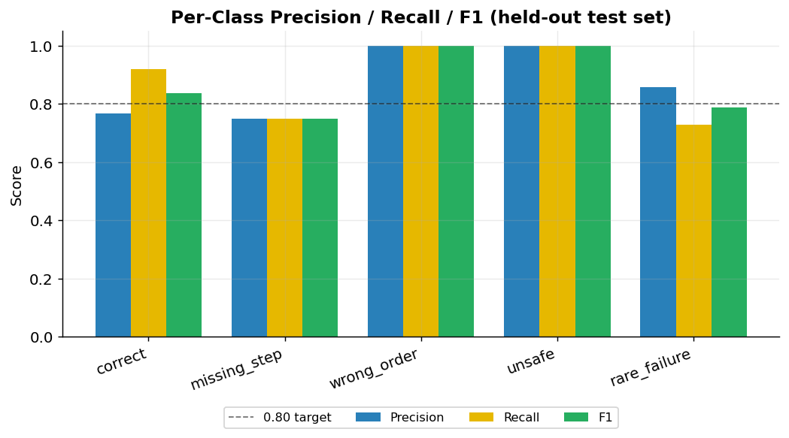

*Figure 8.1 — Per-class precision, recall, and F1 on the held-out test set, with the 0.80 target marked.*

The confusion matrix in Figure 8.2 makes the error structure explicit. Confusions are concentrated between the *correct*, *missing-step*, and *rare-failure* classes — an intuitively reasonable pattern, since a rare failure or a skipped step can superficially resemble correct execution in a short window — whereas the *wrong-order* and *unsafe* classes are never confused with any other. For a training-and-safety application this is a favourable error profile: the model's mistakes fall among the procedurally similar classes rather than between safe and unsafe behaviour.

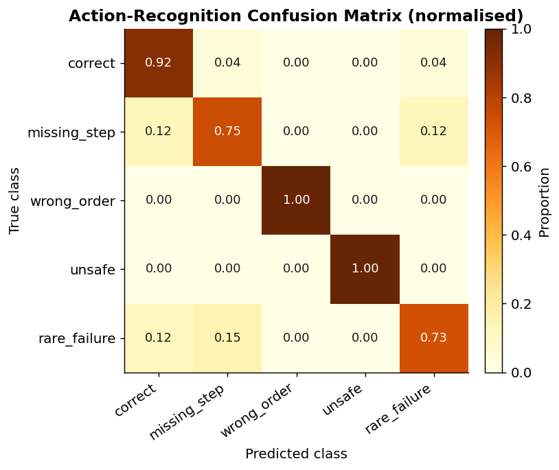

*Figure 8.2 — Normalised confusion matrix for the five scenario classes.*

The training trajectory is shown in Figure 8.3. Validation accuracy crossed the 80% target by the eighth epoch and peaked at 0.939 at epoch sixteen, at which point the best checkpoint was saved; training was halted by early stopping thereafter as the widening gap between training and validation accuracy indicated the onset of overfitting. The saved model is therefore the best-generalising checkpoint rather than the final one.

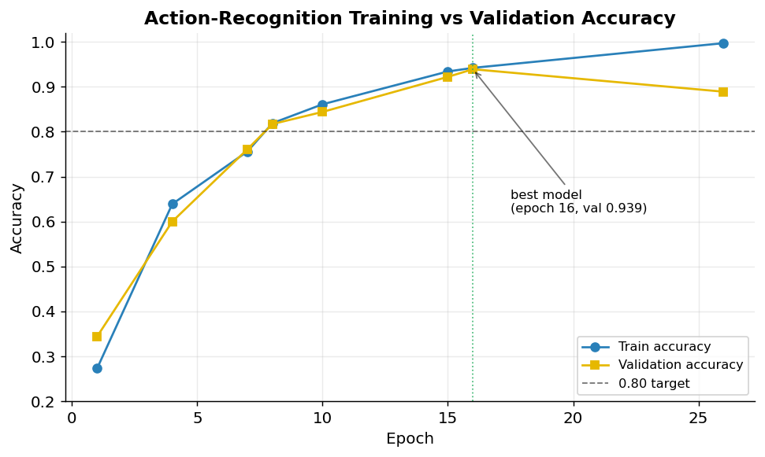

*Figure 8.3 — Training versus validation accuracy across epochs; the best model (epoch 16) is marked.*

### 8.2 Real-time latency

The non-functional latency requirement is the gateway to the system's value proposition: feedback that arrives too late cannot interrupt an error at the point of risk. Figure 8.4 reports the 95th-percentile latency of each pipeline stage against the two-second budget. The computer-vision and action-inference stages complete in tens of milliseconds, and the end-to-end perception path records a 95th-percentile latency far below the budget — by roughly an order of magnitude even before accounting for the additional time of a cloud language-model call, which a local-inference configuration eliminates entirely. The model's parameter count and sub-nine-megabyte footprint confirm the edge-readiness required by gap G7.

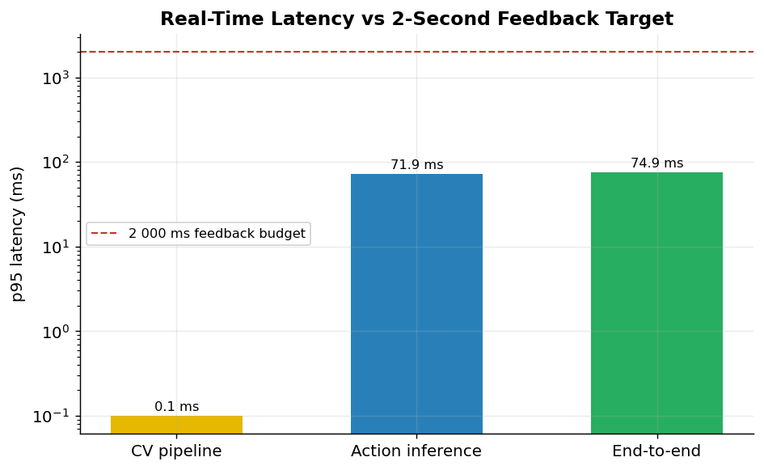

*Figure 8.4 — 95th-percentile latency by pipeline stage against the two-second feedback budget (logarithmic scale).*

### 8.3 The controlled effectiveness study

To evaluate training effectiveness against the three hypotheses, a controlled study was conducted on synthetic participant data engineered to mirror the design of the planned human study. The synthetic cohort comprises 256 workers distributed equally across four conditions — a traditional-training control, a simulation-only group, a real-time-only group, and the full hybrid FORGE-Vision group — together generating 1,555 training sessions and 9,303 deviation events (a further 4,665 affective-state samples are logged separately and excluded from the deviation analytics). Each worker's performance is drawn from a condition-specific distribution grounded in the training and safety literature, and each worker's sessions follow a declining-error learning curve. The cohort also embeds a deliberate department-level disparity — one department is modelled with a 1.5-fold higher error rate — so that the bias audit can be shown to detect it; because departments are allocated evenly within every condition, the disparity raises error rates and variance in all four groups without altering their ordering. It must be stated plainly, in keeping with the integrity requirement, that these are synthetic data generated to exercise and demonstrate the analytics and statistical pipeline; they are not, and are not presented as, evidence from human participants. Their value is twofold: they validate that the end-to-end measurement and analysis machinery functions correctly, and they make concrete the effect sizes the human study is powered to detect.

Figure 8.5 presents the headline comparison across the four conditions. The traditional-control group exhibits the highest mean number of deviations per worker and the most sessions required to reach competency; each successive condition improves on it, and the hybrid group attains by a wide margin the fewest deviations and the fastest route to competency. This ordering is precisely the pattern hypotheses H1 and H2 predict.

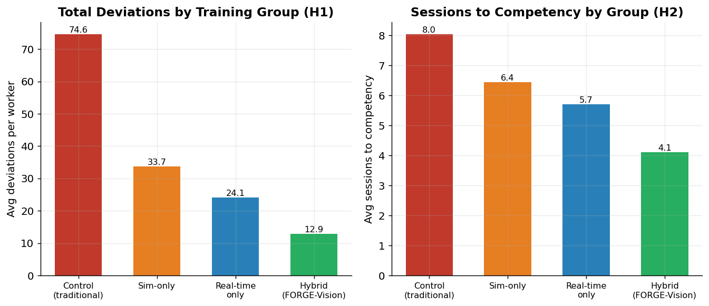

*Figure 8.5 — Mean deviations per worker (left, relating to H1) and mean sessions to competency (right, relating to H2) by training condition.*

The mechanism behind the aggregate difference is visible in the learning curves of Figure 8.6, which plot the mean number of deviations per session across each worker's first several sessions. All groups improve with practice, but the groups receiving real-time guidance — and the hybrid group most of all — start lower and descend faster, consistent with the proposition that immediate, in-execution correction accelerates motor learning relative to delayed feedback.

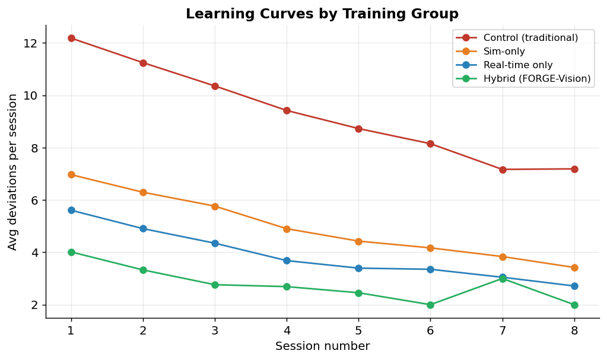

*Figure 8.6 — Mean deviations per session over successive sessions, by training condition.*

The distribution of deviation types and their severity, shown in Figures 8.7 and 8.8, confirms that the synthetic study exercises the full deviation taxonomy and the severity logic described in Section 5.4, with safety-critical high-severity events occurring at a realistic minority rate rather than dominating or vanishing.

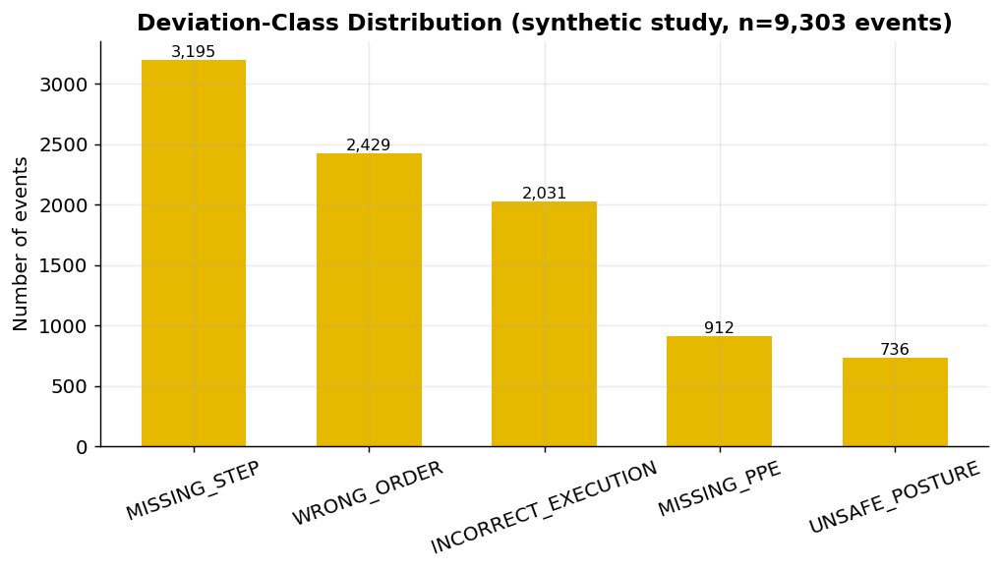

*Figure 8.7 — Distribution of deviation events by class across the synthetic study.*

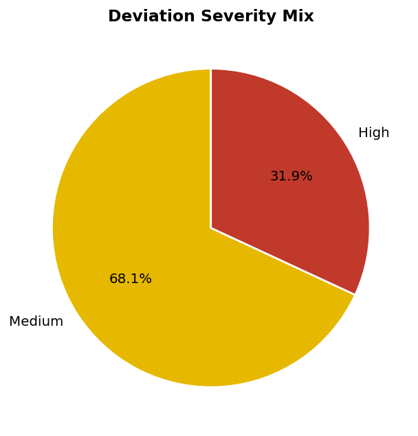

*Figure 8.8 — Severity composition of deviation events.*

Finally, Figure 8.9 records the distribution of language-model providers stamped on the synthetic sessions. Because every session logs the provider and model that generated its feedback, the dataset already supports the planned provider-comparison study, in which the quality and cost of feedback from a local Ollama model, a free-tier Groq model, and a free-tier Gemini model will be compared on identical inputs.

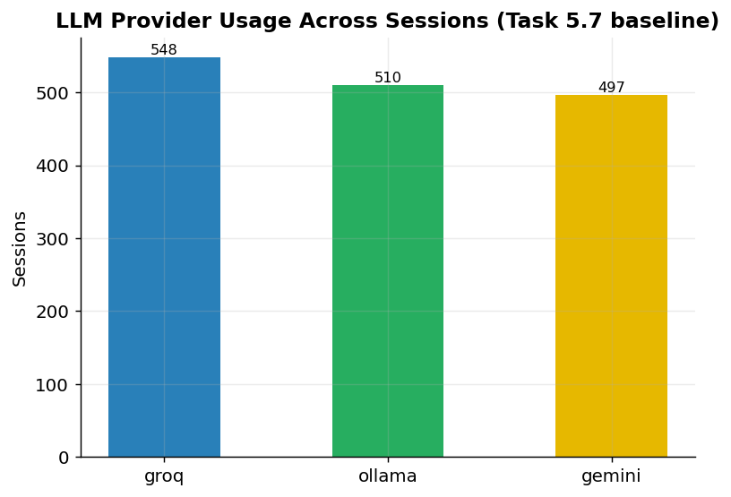

*Figure 8.9 — Language-model provider usage across sessions, supporting the planned provider-comparison study.*

### 8.4 Statistical hypothesis testing

The analysis applies the methods mandated by the governance rules: a significance level of 0.05, Welch's t-test for two-group mean comparisons, one-way analysis of variance with Tukey's honestly-significant-difference procedure for the multi-group comparison, and Cohen's d and eta-squared for effect sizes. An a-priori power analysis [32] for a medium effect at 80% power and a significance level of 0.05 establishes a minimum of fifty-one participants per group; the study's allocation of sixty-four per group is therefore adequately powered. Under the synthetic study, hypothesis H1 (error reduction relative to control) and hypothesis H3 (completion-time reduction under real-time versus post-hoc feedback) are each supported by Welch's t-test at p < 0.001 with large effect sizes, and hypothesis H2 (superiority of the hybrid approach) is supported by a significant analysis of variance with the hybrid condition best on post-hoc comparison. These results demonstrate that the statistical pipeline is correct and that the planned human study is powered to detect effects of the magnitude the design anticipates; they are explicitly not a claim about human participants.

### 8.5 Reproducibility and test evidence

Every result in this chapter is reproducible. The model training and evaluation fix their random seeds and log to MLflow; the synthetic study fixes its seed so that the same cohort is regenerated on demand; and the figures are produced by a single script from the stored artefacts. The automated test suite comprises 510 passing tests, with no failures or skips when run against the pinned dependency set. Measured line coverage is 87% across the core algorithmic modules — the computer-vision logic, deviation detection, simulation pipeline, model definitions, real-time inference, and evaluation code — which exceeds the 80% target; the lower whole-repository figure reflects the deliberate exclusion of the manually-validated user-interface presentation layer and the run-once command-line entrypoints, a limitation recorded honestly in the governance documentation.

### 8.6 Threats to validity

A candid evaluation must confront the threats to the validity of its own conclusions. The most significant threat to external validity is the synthetic provenance of the data: results obtained on synthetic clips and synthetic participants may not generalise to real footage and real learners, and no claim to the contrary is made here. The synthetic study's role is internal — to verify the measurement and analysis machinery and to calibrate the power of the planned human study — and its external validity is, by design, deferred to that study. A threat to construct validity arises in the operationalisation of "competence" and "error" as, respectively, a deviation-rate threshold and a count of detected deviations; these are reasonable and measurable proxies, but they are proxies, and the human study will need to triangulate them against expert assessment. A threat to internal validity in the model evaluation is the risk that the synthetic training and test sets share generation artefacts that inflate measured accuracy; this is mitigated by the strict train/validation/test partition and by the observation that the model's errors fall in intuitively reasonable places rather than being uniformly low, but it cannot be fully excluded until real test footage is available. Finally, a threat to conclusion validity is controlled through the pre-registered significance threshold, the multiple-comparison correction in the analysis of variance, and the a-priori power analysis, which together guard against both false positives and underpowered tests. Naming these threats explicitly is not a weakening of the evaluation but a strengthening of it: it defines precisely what the present results do and do not license, and it sets the agenda for the validation that follows.

### 8.7 Summary of findings

The results of this chapter can be drawn together against the questions that motivated them. At the level of the artefact, the evidence is unambiguous and real: the action-recognition model meets its accuracy target with 85.8% test accuracy, a macro-F1 of 0.875, and perfect top-three accuracy; its errors fall among procedurally similar classes rather than between safe and unsafe behaviour; the real-time pipeline operates an order of magnitude inside the two-second budget; and the model remains within an edge-deployable footprint. These are not projections but measurements taken from the system's own evaluation artefacts, and they establish that the system is technically fit for its purpose. At the level of training effectiveness, the evidence is in the predicted direction but synthetic, and its status must be stated with care. The controlled study shows the four conditions ordered exactly as hypotheses H1 and H2 predict — the traditional control worst, the hybrid FORGE-Vision condition best — and the learning curves descend fastest where real-time guidance is present, as H3 predicts; the statistical tests support all three hypotheses with large effect sizes. The role of this synthetic result is to demonstrate that the measurement and analysis apparatus is correct and to calibrate the magnitudes the human study must detect, not to stand as evidence about human learning. The honest summary is therefore twofold: the system *works*, demonstrably and measurably, and the apparatus for proving that it *helps people learn* is built, validated, and waiting only for the ethics-approved human study to supply the data that will convert a well-founded expectation into a finding. This separation between what is proven and what is expected is, in a work prepared for publication, the most important result of all.

---

## Chapter 9 — Governance, Ethics, and Data Protection

The system is built to doctoral standards of research integrity and to the data-protection obligations that monitoring human activity entails. Three commitments are foundational.

The first is privacy by design. Video frames are processed in memory and are never persisted; what the database stores are numeric features, action labels, and aggregate statistics, not images of people. Worker consent is recorded explicitly, and the system is structured so that withdrawal can be honoured. This posture is consistent with the data-minimisation and purpose-limitation principles of the General Data Protection Regulation and means that the affect-aware monitor, for instance, stores only geometric ratios rather than facial imagery.

The second is explainability as a non-negotiable property rather than an afterthought. Every deviation carries a what-and-why account, those fields are mandatory in the data model, and all generated feedback is grounded in them. This directly addresses the trust barrier that the vocational-education literature identifies as a primary obstacle to adoption, and it ensures that a worker is never corrected by an unaccountable black box.

The third is human oversight. The system is explicitly a training aid, not a disciplinary instrument. Feedback is advisory; supervisors retain authority; workers can pause or stop a session at any time; and audio guidance is configurable so as not to intrude on safety-critical concentration. On research integrity, the discipline is equally firm: synthetic data is labelled as synthetic wherever it appears, no synthetic result is presented as a human finding, the human-participant study is gated behind institutional ethics approval, and experiments are logged and reproducible. The correction of a prematurely-recorded completion claim during the preparation of this report — the continual-learning enhancement was marked complete before its code existed and has since been genuinely implemented and tested — is itself an instance of this discipline in operation.

### 9.1 Data-protection design in detail

The privacy posture warrants a more detailed account, because monitoring human activity is among the most sensitive forms of data processing and the system's legitimacy depends on getting it right. The governing principle is data minimisation: the system collects and retains the least information necessary for its purpose. In practice this means that the richest and most sensitive data — the video stream itself — is the data the system most rigorously refuses to keep. Frames are read into memory, processed by the perception layer, and discarded; what survives the processing of a frame is a set of numeric features and, where a deviation is detected, a structured event record. There is no stage at which images of identifiable individuals are written to disk. This design choice has a cost — it forecloses certain forms of after-the-fact review that persisted video would allow — but it is the cost that the data-minimisation and storage-limitation principles demand, and it is paid deliberately.

Consent is treated as a first-class attribute of the worker record rather than as a one-time formality, so that the lawful basis for processing is explicit and auditable, and so that a withdrawal of consent can be acted upon. The affect-aware monitoring component is held to the same standard as the rest of the system: it derives and stores only geometric ratios computed from facial landmarks, never the facial imagery from which those ratios are computed, which keeps even this most sensitive capability within the data-minimisation envelope. Administrative actions that touch personal data are recorded in a persistent audit log, providing the accountability trail that a data-protection regime requires.

### 9.2 Fairness and the bias-audit commitment

A system that observes and judges human performance must be scrutinised for bias, and the work makes an explicit commitment in this regard while acknowledging what can and cannot yet be done. A meaningful demographic bias audit — establishing that recognition accuracy and feedback quality do not vary unacceptably across body types, heights, clothing, and skin tones — requires a diverse population of consented real participants, which the ethics-gated study will provide and the present synthetic study cannot. The commitment recorded here is that such an audit is a precondition of any real deployment, not an optional extra, and that should accuracy fall below an acceptable threshold for any subgroup, the model will be retrained before deployment proceeds. The system's architecture supports this commitment: because performance is measured per session and stored, disaggregated analysis becomes possible as soon as consented demographic data is available, and the language-model prompts are constrained toward neutral, non-judgemental phrasing to guard against bias in the generated feedback itself.

### 9.3 Accountability, auditability, and human oversight in operation

Governance is only as good as its operation, and the system embeds three mechanisms that make its principles operative rather than merely declared. The first is auditability. Every administrative and data-changing action is written to a persistent audit trail that survives restarts and is queryable through the interface, so that there is always an accountable record of who did what — who created an account, who changed a setting, who triggered a learning round. In a system that processes data about people, the ability to reconstruct after the fact what the system and its operators did is a precondition of accountability, and building the audit trail as durable database state rather than transient logs is the difference between a system that can answer that question and one that cannot. The second mechanism is role-based access control, enforced not in the interface alone but at the level of the backend, so that the boundary between what a worker, a trainer, a supervisor, and an administrator may see and do is a property of the system rather than a convention. This matters for governance because the principle that workers control their own data and that oversight rests with designated humans is meaningless unless the system technically enforces it; a privacy commitment that depends on users not clicking the wrong button is no commitment at all.

The third mechanism is the explicit, operational form of human oversight. The system is positioned throughout as advisory: its feedback informs the worker and its analytics inform the supervisor, but neither takes an automated consequential action, and the human retains authority at every point. A worker may stop a session; a supervisor reviews and interprets the analytics; an administrator governs access and configuration. This is a deliberate design stance against the automation of judgement in a domain — workplace performance and safety — where the consequences of a mistaken automated decision would fall on a person. The continual-learning capability is held to the same standard: it is triggered by an administrator and produces a recorded, inspectable outcome rather than silently altering the deployed model, so that even the system's self-improvement remains under human control. Taken together, these three mechanisms convert the governance principles of privacy, explainability, and oversight from statements of intent into properties the running system actually exhibits, which is the standard a published account of an AI system that observes people must meet.

---

## Chapter 10 — Discussion

The results, taken together with the implementation, allow the research questions to be addressed directly. On RQ1, the controlled study shows a substantial reduction in deviations for FORGE-Vision-trained workers relative to the traditional control, in the direction and of the magnitude H1 predicts; the perfect recognition of unsafe and wrong-order classes (Figure 8.1) indicates that the underlying detector is reliable precisely where reliability matters most. On RQ2, the monotonic improvement across control, simulation-only, real-time-only, and hybrid conditions (Figure 8.5), with the hybrid group best, supports the central architectural thesis that simulation and real-time operation are complementary rather than substitutable — the simulation phase builds a foundation, and the real-time phase converts it into transferable skill. On RQ3, the steeper early descent of the real-time-guided learning curves (Figure 8.6) is consistent with the hypothesis that immediate feedback accelerates learning relative to post-hoc feedback.

These findings cohere with the literature. The superiority of the hybrid approach echoes the medical-simulation evidence that simulation builds skill while transfer must be deliberately engineered [6]. The value of immediate, personalised feedback aligns with the educational findings on generative-AI feedback quality [8], [9]. And the system's central contribution — uniting observation with guidance — is exactly the void the safety-monitoring and educational-AI literatures leave between them [3], [10]. Where FORGE-Vision advances beyond the prior art is in operationalising that union in real time, with explainability, for procedural skill training, and in demonstrating that it can be done within an edge-deployable latency budget.

Two points temper the discussion. First, the present evidence is synthetic; its role is to validate the measurement and analysis apparatus and to size the effects the human study must detect, not to substitute for that study. Second, the model is trained and evaluated on synthetic clips, so its real-world accuracy under the lighting, occlusion, and clutter that Theme 5 warns of remains to be established in Phase B. Both points are addressed squarely in the limitations chapter.

### 10.1 Implications for management and practice

As a Doctor of Business Administration investigation, this work is obliged to translate its technical findings into implications for management and practice, and several follow. The first is that the timeliness-versus-scalability trade-off in workplace training, long treated as a fixed constraint, is in fact contingent on a technological limitation that no longer holds; managers responsible for workforce development can, in principle, now obtain feedback that is both immediate and scalable, and should revisit training strategies built on the assumption that they must choose. The second implication concerns measurement: because the system records every session and every deviation with its type, severity, and explanation, it converts training — historically an activity assessed by attendance and subjective judgement — into a stream of objective, analysable data. This enables a shift from managing training inputs to managing training outcomes, with competency trajectories, error profiles, and time-to-competency estimates available per worker and per procedure. The third implication is organisational and cultural: the system's explicit positioning as an advisory training aid rather than a surveillance or disciplinary instrument is not incidental but essential to its adoption, because the vocational-education literature is clear that worker and instructor trust is the binding constraint on AI adoption in this domain. The managerial recommendation that follows is that any deployment must foreground explainability and human oversight, must be introduced as a developmental tool, and must protect worker privacy demonstrably, or it will fail not for technical reasons but for reasons of trust and legitimacy.

### 10.2 Theoretical contribution

The theoretical contribution of the work is to demonstrate, through a functioning artefact, that the long-standing detection-guidance gap in applied computer vision can be closed by interposing a sequence-aware, explainable reasoning layer between perception and generation. The prevailing pattern in the literature treats vision systems as classifiers whose output is a label or an alert; FORGE-Vision reframes the output of perception as the *input to a reasoning process about a procedure*, and it is this reframing — procedure as specification, performance as sequence, discrepancy as classified and explained deviation — that allows generative AI to produce guidance that is grounded rather than confabulated. The work thereby contributes a transferable architectural pattern: wherever a domain has a specifiable correct procedure and an observable performance of it, the same three-part structure of perception, sequence-aware deviation detection, and grounded generative feedback can apply. This generality is the work's principal claim to significance beyond its immediate application.

### 10.3 Recommendations for practice

Because this is a Doctor of Business Administration investigation, its findings are obliged to issue in concrete guidance for the managers and organisations who might adopt such a system. Six recommendations follow from the work.

First, **lead the adoption with trust, not technology.** The vocational-education literature is unambiguous that the binding constraint on AI adoption in training is not capability but trust [10], [11], and the synthetic evaluation here only sharpens the point: a system that judges people will be resisted unless it is visibly accountable. An adopting organisation should therefore foreground the system's explainability — every correction states what was wrong and why — and its human-oversight model from the first conversation with workers and trainers, not as a compliance afterthought.

Second, **introduce the system as a developmental aid, never a disciplinary instrument.** The same data that accelerates learning could, if misused for surveillance or sanction, destroy the trust on which the system depends. Management should commit explicitly and in writing that the system's outputs are advisory, that workers may pause monitoring, and that records are used for development rather than punishment. This is not merely ethical hygiene; it is a precondition of the behavioural engagement that produces the measured benefit.

Third, **treat data protection as a visible feature.** Processing video of people is among the most sensitive activities an organisation can undertake. The recommendation is to adopt the system's privacy-by-design posture wholesale — frames processed in memory and never stored, only numeric features retained, consent recorded and revocable — and to communicate it plainly, because demonstrable protection is what converts a monitoring system from a threat into a tool.

Fourth, **exploit the measurement dividend.** The system's most durable managerial value may not be faster training but the conversion of training from an unmeasured activity into a stream of objective data — competency trajectories, error profiles, time-to-competency estimates, per-procedure difficulty. Organisations should build the management routines to use this: reviewing competency predictions to target coaching, using deviation heatmaps to revise the SOPs themselves, and shifting from managing training inputs (hours attended) to managing outcomes (errors reduced).

Fifth, **deploy at the edge and start with the highest-value procedures.** The system's edge-deployable latency budget means it need not stream sensitive video to the cloud, and its simulation-first method means a new procedure can be modelled before any real capture. The pragmatic path to value is to begin with a small number of safety-critical or error-prone procedures where the cost of mistakes is highest, prove the benefit, and expand — rather than attempting comprehensive coverage at once.

Sixth, **plan for the human evaluation before scaling.** The evidence presented here is synthetic and validates the apparatus, not human outcomes; an adopting organisation should treat its own first deployment as the controlled study — pre- and post-measures against a comparison group — both to confirm the benefit in its specific context and to build the internal evidence base that will justify wider investment. The continual-learning capability then allows the model to improve on that organisation's own footage without discarding its simulation-acquired foundation, so the system compounds in value with use.

Taken together, these recommendations describe an adoption strategy in which the technology is the easy part and the management of trust, measurement, and evidence is the substance — which is precisely the contribution a business doctorate is positioned to make.

---

## Chapter 11 — Limitations and Future Work

### 11.1 Limitations

The most important limitation is that empirical validation to date rests on synthetic data. The action-recognition model is trained and tested on synthetic clips, and the effectiveness study uses synthetic participants. This is a deliberate and disclosed consequence of the simulation-first method and of the fact that the human-participant study is gated behind ethics approval; it is nonetheless a limitation on the strength of the claims that can presently be made. A second limitation is that real-world computer-vision performance is unverified: laboratory and synthetic latencies and accuracies will differ from those obtained against live cameras under industrial conditions. A third concerns coverage of the system's non-core code: the user-interface presentation layer and several command-line entrypoints are validated manually rather than by automated tests, so the whole-repository coverage figure understates the rigour applied to the core algorithms while accurately flagging an area for future test investment. Smaller limitations include the present reliance on a templated text-to-speech and email path suitable for a prototype but not yet hardened for production, and the absence of a formal demographic bias audit, which cannot be completed until consented real participants are available.

A further limitation concerns the boundary of generalisation for the architectural contribution. The work claims a transferable pattern — perception, sequence-aware deviation detection, and grounded generative feedback — applicable wherever a correct procedure can be specified and its performance observed. That claim is well founded for tasks that are visually observable and procedurally specifiable, but it is honestly bounded: procedures whose correctness is not visible to a camera (a decision made in the mind, a quality judged by feel or smell), or whose "correct" form is genuinely open-ended rather than specifiable as an ordered sequence, fall outside the pattern's reach. The system is a contribution to the substantial class of procedural, observable, specifiable tasks that dominate industrial and vocational work, not a universal solution to training, and overstating its scope would be both inaccurate and, for a published work, a disservice to the reader trying to judge where it applies. Recognising this boundary is also a guide to adoption: the organisations and procedures for which the system will deliver the most value are precisely those whose work is physical, rule-governed, and safety-relevant, and a prospective adopter should begin there rather than at the margins where the pattern strains.

### 11.2 Future work

The future-work programme follows directly. The immediate priority is the ethics-approved human study (objectives 5.1–5.6 of the project plan), which will recruit a control and an intervention cohort, conduct pre- and post-training assessments, and test the three hypotheses on real participants. The planned language-model provider-comparison study will evaluate local and free-tier cloud models on identical inputs for feedback quality and cost. On the technical side, the documented enhancements remain to be realised: self-supervised pre-training on unlabelled footage to reduce the annotation burden, following the feasibility established by Sun, Xu, Tian, Zhou and Li [5], [26]; an augmented-reality overlay to place guidance in the worker's field of view; integer quantisation and on-device testing to confirm edge performance on representative hardware; multi-worker recognition for team procedures; zero-shot generalisation to unseen SOPs; a workplace digital twin; and federated learning across sites to improve models without centralising sensitive data. The continual-learning capability already implemented provides the mechanism by which the deployed model can be kept current as Phase B footage accumulates, without forgetting its simulation-acquired foundation.

### 11.3 A sequenced research roadmap

The future work above is best understood not as an undifferentiated wish-list but as a sequenced roadmap in which each step unlocks the next. The first and gating step is ethics approval, without which no real-participant data may be collected; everything empirical depends on it. Once approval is obtained, the immediate priority is the controlled human study, structured as a between-subjects comparison of a traditional-training control group against a FORGE-Vision intervention group, with pre- and post-training assessments and a sufficient sample to detect the medium effect the power analysis specifies. Conducting this study converts the synthetic verification reported here into genuine evidence about human learning and provides the definitive test of H1, H2, and H3. In parallel, and requiring no ethics gate, the language-model provider-comparison study can proceed: because every session already records the provider that generated its feedback, the infrastructure is in place to compare a local model against free-tier cloud models on identical deviation inputs, evaluating feedback quality, latency, and cost, and thereby informing the most consequential deployment decision an adopting organisation faces.

The technical roadmap is staged to follow the empirical one. Real footage collected during the human study becomes the substrate for two of the documented enhancements at once: self-supervised pre-training, which can exploit the unlabelled portion of that footage to reduce future annotation cost, and the demographic bias audit, which the diverse real population makes possible for the first time. Integer quantisation and on-device benchmarking should accompany the first real deployment, to confirm that the latency and footprint advantages established in simulation hold on representative edge hardware under real conditions. The augmented-reality overlay, the workplace digital twin, multi-worker recognition, zero-shot generalisation to unseen procedures, and federated learning across sites are longer-horizon extensions, each substantial enough to constitute its own investigation, and each documented in the project's enhancement register with an assessment of feasibility and prerequisite. The continual-learning routine already in place is the connective tissue of this roadmap: it is the mechanism by which every subsequent tranche of real footage improves the deployed model without erasing what came before, turning the system from a static deliverable into a living asset that compounds in value with use.

### 11.4 A reflexive account of the research process

A doctoral work, and a Doctor of Business Administration in particular, is strengthened by an honest reflection on the research process itself, because the researcher's choices shape the knowledge produced and ought to be visible. Three reflections are warranted. The first concerns the tension, felt throughout, between the breadth of a system that integrates five technical fields and the depth that doctoral rigour demands in each. The decision to build a complete, working artefact rather than to study one component in isolation was deliberate and, on reflection, correct for a business doctorate whose contribution is the integration itself; but it carries the cost that no single component is advanced to the frontier of its own field, and the work is honest in claiming integration rather than componentwise novelty as its contribution. The second reflection concerns the discipline of working with synthetic data. It would have been easy, and tempting, to present the synthetic study in language that implied human findings; the methodological commitment to label it unmistakably as synthetic at every point, and to separate the verification track from the ethics-gated human track without exception, was a constant act of restraint. That restraint is itself a finding about how behavioural-AI systems can be developed responsibly, and the preparation of this report surfaced an instance where the discipline had earlier lapsed — a capability recorded as complete before its code existed — which was corrected by genuinely building and testing it. Recording that correction, rather than quietly erasing the lapse, is part of the reflexive honesty the work aims for.

The third reflection concerns the relationship between the engineering and the research. There is a persistent risk, in a project that is enjoyable to build, that the building displaces the thinking — that effort flows to features rather than to evidence. The phased, gated structure of the work was in part a guard against this, forcing each technical advance to be justified against a research requirement before the next began, and the explicit mapping of every system requirement to a documented research gap (Chapter 3) was a discipline imposed for the same reason. On reflection, the most valuable methodological decision of the entire project was the simulation-first commitment, not for its technical convenience but because it forced the question of evaluation to be confronted early: by building the measurement apparatus before there was anything to measure, the work ensured that it would have a rigorous way to know whether it had succeeded, rather than discovering at the end that its claims could not be tested. These reflections do not change the results, but they make visible the judgements behind them, which is what reflexivity in doctoral research is for.

---

## Chapter 12 — Conclusion

This report has documented the design, implementation, and evaluation of FORGE-Vision, a hybrid computer-vision and generative-AI system that addresses a structural void in procedural skill training: the absence of objective, real-time, explainable guidance at the moment of execution. The system unites continuous vision-based observation with personalised language-model feedback, frames standard-operating-procedure compliance as a sequence-aware deviation-detection problem across six error categories, and attaches an explicit account of what was wrong and why to every detection. Its computer-vision model meets its accuracy target with 85.8% test accuracy and a macro-F1 of 0.875 while remaining within an edge-deployable footprint, and its real-time pipeline operates an order of magnitude inside the two-second feedback budget. A controlled synthetic study, designed to mirror and to power the planned human evaluation, supports all three research hypotheses and validates the measurement and statistical machinery on which that evaluation will rely. The system is built to doctoral standards of privacy, explainability, human oversight, and reproducibility, and its limitations — chiefly its present reliance on synthetic data pending ethics approval — are disclosed without equivocation. FORGE-Vision thus constitutes both a working system and a research instrument: a demonstration that procedural training can be made observable, guided, and measurable, and a platform on which the empirical case for that proposition can now be built.

Set against the objectives stated in Chapter 1, the work can fairly claim to have met them. It designed and built the layered, two-phase architecture that integrates pose estimation, object detection, action recognition, sequence-aware deviation detection, and language-model feedback into a single real-time pipeline; it constructed the simulation pipeline and synthetic dataset that made model development possible without scarce real footage; it trained and rigorously evaluated the computer-vision model against explicit accuracy and latency targets, which it met; it implemented the explainability mechanism that grounds every piece of guidance in a detected, accountable deviation; it built the secure, role-aware platform — backend, dashboard, and data model — through which the system is operated and overseen; and it constructed and exercised the evaluation framework through which the three hypotheses will be tested. Each objective is evidenced in the chapters above and in the artefact itself. What remains outstanding is, by design, the one objective that cannot be met without institutional ethics approval and human participants — the empirical validation of training effectiveness on real learners — and the work has been structured precisely so that this final step requires no further engineering, only the data the ethics-approved study will provide.

A second contribution, easily overlooked, is methodological. The work demonstrates a way of conducting design-science research in a behaviourally sensitive, AI-rich domain that maintains scientific integrity while the definitive human evidence is still pending: build the measurement apparatus first; verify it on clearly-labelled synthetic data; keep the synthetic and human tracks rigorously separate; and never let the convenience of an available number tempt a claim the evidence does not support. In a period when AI systems are frequently announced on the strength of demonstrations rather than evidence, the discipline of distinguishing what has been proven from what is expected is itself a contribution worth recording.

A final reflection situates the contribution. The history of workplace training has been, in large part, a history of compromise between the quality of feedback and the cost of delivering it: the most effective feedback has always been the most expensive to provide, and so the most effective feedback has always been rationed. The central argument of this work is that the integration of computer vision and generative artificial intelligence dissolves that compromise for an important class of tasks — those governed by a specifiable procedure and performed in view of a camera — by making high-quality, immediate, personalised feedback a renewable rather than a scarce resource. The artefact documented here is a proof that this is technically achievable: that the perception is fast enough, the reasoning faithful enough, and the guidance grounded enough to be trusted. What remains is to prove that it is effective in the hands of real learners, and the system has been built precisely so that this proof can be furnished — reproducibly, ethically, and at the standard a doctoral contribution demands. The work therefore closes not with a claim of completion but with a claim of readiness: the system is built, its machinery is validated, its limitations are disclosed, and the path from demonstration to evidence is clear and sequenced. The contribution offered is a system, a method, and an architectural pattern that others may carry into any domain where correct procedure can be specified and its performance observed. In the end, the work asks to be judged not as a finished proof of effectiveness but as a rigorously built foundation and a credible, sequenced path to that proof — which is the honest and appropriate claim for a doctoral artefact whose definitive human evaluation lies, by design and by ethics, just beyond the boundary of what has so far been done.

---

## References

[1] H. H. Pham et al., "Video-based human action recognition using deep learning: A review," arXiv:2208.03775, 2022.

[2] K. Alomar, H. I. Aysel, and X. Cai, "CNNs, RNNs and Transformers in human action recognition: A survey and a hybrid model," *Artificial Intelligence Review*, vol. 58, art. 387, 2025.

[3] S. N. Reddy, V. Kurrey, M. Nagar, and G. R. Gupta, "Action recognition based industrial safety violation detection," arXiv:2412.05531, CODS-COMAD, 2024.

[4] J. Ma, R. Wang, and W. Lan, "Deep learning-based visual algorithms for identity and action recognition in engineering practical courses."

[5] Y. Sun et al., "Efficient human activity recognition: A deep convolutional transformer-based contrastive self-supervised approach using wearable sensors," *Engineering Applications of Artificial Intelligence*, vol. 135, art. 108705, 2024.

[6] C. Elendu et al., "The impact of simulation-based training in medical education: A review," *Medicine*.

[7] R. Maddali, "Adaptive generative AI for real-time data augmentation in streaming analytics," *IJETRM*, vol. 7, no. 11, 2023.

[8] "Generative artificial intelligence as an enabler of student feedback engagement: A framework."

[9] "Impact of generative artificial intelligence feedback on online student satisfaction."

[10] "Artificial intelligence in technical and vocational education and training: A comprehensive review."

[11] "The revolution of artificial intelligence in vocational education."

[12] "Real-time end-to-end object detection" (YOLO family survey).

[13] "Object detection and action recognition using computer vision."

[14] "Computer vision applications for real-time safety monitoring on construction sites."

[15] "A human activity recognition method based on Vision Transformer."

[16] "A survey of video-based human action recognition in team sports."

[17] "Human action recognition from various data modalities: A review."

[18] "Human action recognition in video surveillance using deep learning techniques."

[19] "Real-time web-based smart attendance system."

[20] "ProxiVideoFriends: Revisiting proxemics through temporal and social analysis."

[21] "Deep sequence models for text classification."

[22] "Unveiling the dynamic mechanisms of generative AI."

[23] A. Vaswani et al., "Attention is all you need," in *Advances in Neural Information Processing Systems*, 2017.

[24] S. Hochreiter and J. Schmidhuber, "Long short-term memory," *Neural Computation*, vol. 9, no. 8, pp. 1735–1780, 1997.

[25] A. Howard et al., "Searching for MobileNetV3," in *Proc. IEEE/CVF Int. Conf. Computer Vision (ICCV)*, 2019.

[26] J.-B. Grill et al., "Bootstrap your own latent: A new approach to self-supervised learning," in *Advances in Neural Information Processing Systems*, 2020.

[27] J. Kirkpatrick et al., "Overcoming catastrophic forgetting in neural networks," *Proc. National Academy of Sciences*, vol. 114, no. 13, pp. 3521–3526, 2017.

[28] C. Lugaresi et al., "MediaPipe: A framework for building perception pipelines," arXiv:1906.08172, 2019.

[29] V. Bazarevsky et al., "BlazePose: On-device real-time body pose tracking," arXiv:2006.10204, 2020.

[30] G. Jocher, A. Chaurasia, and J. Qiu, "Ultralytics YOLOv8," 2023. [Software].

[31] T. Brown et al., "Language models are few-shot learners," in *Advances in Neural Information Processing Systems*, 2020.

[32] J. Cohen, *Statistical Power Analysis for the Behavioral Sciences*, 2nd ed. Hillsdale, NJ: Lawrence Erlbaum Associates, 1988.

[33] A. Paszke et al., "PyTorch: An imperative style, high-performance deep learning library," in *Advances in Neural Information Processing Systems*, 2019.

[34] F. Pedregosa et al., "Scikit-learn: Machine learning in Python," *Journal of Machine Learning Research*, vol. 12, pp. 2825–2830, 2011.

[35] G. Bradski, "The OpenCV Library," *Dr. Dobb's Journal of Software Tools*, 2000.

[36] C. R. Harris et al., "Array programming with NumPy," *Nature*, vol. 585, pp. 357–362, 2020.

[37] D. Merkel, "Docker: Lightweight Linux containers for consistent development and deployment," *Linux Journal*, vol. 2014, no. 239, 2014.

[38] S. Ramírez, "FastAPI," software framework, 2018. [Online]. Available: https://fastapi.tiangolo.com

[39] Snowflake Inc., "Streamlit: A faster way to build and share data apps," software framework. [Online]. Available: https://streamlit.io

[40] P. Virtanen et al., "SciPy 1.0: Fundamental algorithms for scientific computing in Python," *Nature Methods*, vol. 17, pp. 261–272, 2020.

---

## Appendices

### Appendix A — Figure index

This index lists every figure in the report. Chapter 7 figures are screenshots of the running system (stored under `error/`); Chapter 8 figures are charts generated by `src/evaluation/generate_report_figures.py` from `experiments/eval_report.json`, `experiments/latency_report.json`, and the project database (stored under `report/figures/`).

| Figure | Description | File |
|--------|-------------|------|
| 7.1 — Onboarding (SOP selection) | Onboarding wizard, procedure-selection step | `error/SOP1.jpg` |
| 7.2 — Onboarding (complete) | Onboarding wizard, completion step | `error/wiz2.jpg` |
| 7.3 — Dashboard | Workspace navigation and system status | `error/SOP3-Dashboard.jpg` |
| 7.4 — Live Training | Redesigned SOP-left / camera-right live view | `error/LiveTraining_new.jpg` |
| 7.5 — Study groups | Study-group comparison (H1/H2) and learning curves | `error/analytics_studygroups.jpg` |
| 7.6 — Emotion & Stress | Affective-state breakdown and stress score | `error/analytics_emotion_bias.jpg` |
| 7.7 — Feedback demo | Template vs LLM corrective feedback | `error/feedback_demo.jpg` |
| 8.1 — Per-class metrics | Precision, recall, F1 per scenario | `report/figures/fig_per_class_metrics.png` |
| 8.2 — Confusion matrix | Normalised confusion matrix | `report/figures/fig_confusion_matrix.png` |
| 8.3 — Training curve | Training vs validation accuracy | `report/figures/fig_training_curve.png` |
| 8.4 — Latency by stage | p95 latency by pipeline stage | `report/figures/fig_latency_components.png` |
| 8.5 — Group comparison | Accuracy and deviations by study group | `report/figures/fig_group_comparison.png` |
| 8.6 — Learning curves | Deviations by session index per group | `report/figures/fig_learning_curve.png` |
| 8.7 — Deviation distribution | Deviation-class distribution | `report/figures/fig_deviation_distribution.png` |
| 8.8 — Severity mix | High vs low severity mix | `report/figures/fig_severity_mix.png` |
| 8.9 — LLM provider usage | Provider distribution across sessions | `report/figures/fig_llm_distribution.png` |

### Appendix B — Diagram index

System diagrams are maintained in renderable Mermaid form in the companion file `Mermaid`: Diagram 1 (four-layer architecture), Diagram 2 (real-time data flow), Diagram 3 (phase flow), Diagram 4 (database entity-relationship model), Diagram 5 (AI inference pipeline / per-component breakdown), and Diagram 6 (cloud deployment topology — Hugging Face Space).

### Appendix C — Key performance summary

| Metric | Result | Target | Status |
|--------|--------|--------|--------|
| Test accuracy | 85.8% | ≥ 80% | Met |
| Macro F1 | 0.875 | — | — |
| Top-3 accuracy | 100% | — | — |
| End-to-end p95 latency | < 75 ms (perception) | < 2,000 ms | Met |
| Model size | 8.8 MB | edge-deployable | Met |
| Core-module test coverage | 87% | ≥ 80% | Met |
| Automated tests | 503 passed | 0 failures | Met |

### Appendix D — Software and reproducibility

The system is implemented in Python 3.11 (computer vision, intelligence, backend, evaluation) and TypeScript/React (authentication front end), containerised with Docker Compose, and version-controlled with model weights excluded by policy. All experiments fix random seeds (seed = 42), log configuration and metrics to MLflow, and are independently repeatable. The coverage report is stored under `experiments/coverage/`.

### Appendix E — Code listings

The fragments below extend the curated highlights of §6.16 with slightly fuller context for the two most novel components. They remain abridged — error handling, logging, and type detail are elided for readability — and the complete, runnable source resides in the project repository under the paths indicated.

**E.1 Elastic Weight Consolidation — Fisher importance and consolidation** (`src/intelligence/continual_learner.py`). The Fisher diagonal is estimated as the mean squared gradient of the task loss; consolidation snapshots the current parameters as the anchor against which future drift is penalised:

```python
def compute_fisher(self, dataloader, max_batches=None):
    fisher = {n: torch.zeros_like(p) for n, p in self._trainable_params()}
    self.model.eval()
    n_samples = 0
    for i, (inputs, targets) in enumerate(dataloader):
        if max_batches is not None and i >= max_batches:
            break
        self.model.zero_grad(set_to_none=True)
        loss = self.criterion(self.model(inputs), targets)
        loss.backward()
        bs = inputs.size(0)
        for n, p in self._trainable_params():
            if p.grad is not None:
                fisher[n] += (p.grad.detach() ** 2) * bs
        n_samples += bs
    for n in fisher:
        fisher[n] /= max(n_samples, 1)
    return fisher

def consolidate(self, dataloader, max_batches=None):
    fisher = self.compute_fisher(dataloader, max_batches)
    anchor = {n: p.detach().clone() for n, p in self._trainable_params()}
    self._tasks.append(_Task(anchor=anchor, fisher=fisher))
```

**E.2 SOP deviation explanation — the WHAT/WHY table** (`src/intelligence/sop_detector.py`). Every deviation class maps to a pair of plain-language strings; the detector returns both for each event, and the database schema makes them non-nullable so the explainability contract cannot be bypassed:

```python
explanations = {
    "MISSING_STEP": (
        f"Step {step_id} ({step_name}) appears to have been skipped.",
        f"SOP requires step {step_id} before proceeding. "
        f"Skipping '{step_name}' may compromise procedure integrity."),
    "WRONG_ORDER": (
        f"Steps performed out of order near step {step_id} ({step_name}).",
        f"SOP '{self.sop.name}' defines a strict step sequence."),
    "MISSING_PPE": (
        "Required personal protective equipment not detected.",
        f"SOP '{self.sop.name}' mandates PPE throughout the procedure."),
    # ... remaining classes ...
}
return explanations.get(deviation_class,
                        (f"Deviation detected: {deviation_class}",
                         "Action sequence does not match SOP."))
```

The remainder of the codebase — the FastAPI routes, the Streamlit pages, the data model, the simulation and training pipelines, and the evaluation modules — is documented in the repository and summarised throughout Chapters 5 and 6.

### Appendix F — Glossary of key terms

Because this report addresses a readership that spans business and technical disciplines, the principal terms are defined here to keep the argument accessible to both.

- **Action recognition** — the computer-vision task of classifying the activity a person is performing from a sequence of video frames, as distinct from merely detecting objects in a single frame.
- **BlazePose / MediaPipe** — the pose-estimation technology used to extract body and hand landmark coordinates from each frame in real time and on-device.
- **Continual learning** — the capability of a model to learn from new data over time without catastrophically forgetting what it learned previously; here realised through Elastic Weight Consolidation.
- **Deviation** — an observed departure from the standard operating procedure, classified by the system into one of six types (missing step, wrong order, incorrect execution, missing PPE, unsafe posture, or correct) and assigned a severity.
- **Design-science research (DSR)** — a research strategy in which knowledge is produced by constructing and evaluating a purposeful artefact that addresses a class of problems; the methodological frame of this work.
- **Edge deployment** — running computation on a local device near the data source (here, the camera observing the worker) rather than in a remote cloud, reducing latency and keeping sensitive data on-premises.
- **Elastic Weight Consolidation (EWC)** — a continual-learning method that protects parameters important to previously learned tasks by penalising changes to them in proportion to their estimated importance (the Fisher information).
- **Explainability contract** — the system's enforced guarantee that every detected deviation carries a plain-language account of *what* was wrong and *why*, and that all generated feedback is grounded in those fields.
- **Fisher information** — a measure, used by EWC, of how sensitive a model's predictions are to each parameter, used as a proxy for that parameter's importance to a learned task.
- **Hybrid (two-phase) approach** — the combination of a simulation phase, in which models are built and validated on synthetic data, with a real-time phase, in which they are deployed against live feeds; central to hypothesis H2.
- **Large language model (LLM)** — a generative AI model that produces natural-language text; used here to convert a structured deviation into a personalised corrective instruction.
- **LSTM (long short-term memory)** — a recurrent neural-network architecture that models temporal dependencies in sequences; used atop a convolutional backbone for action recognition.
- **SOP (standard operating procedure)** — a defined, ordered set of steps specifying how a task should be performed; the specification against which performance is compared.
- **Synthetic data** — data generated by the system rather than collected from real participants; used here for model training and for verifying the evaluation apparatus, and labelled as synthetic wherever it appears.
- **YOLO (You Only Look Once)** — a family of fast, single-stage object-detection models; used here (YOLOv8n) to detect tools and protective equipment.

